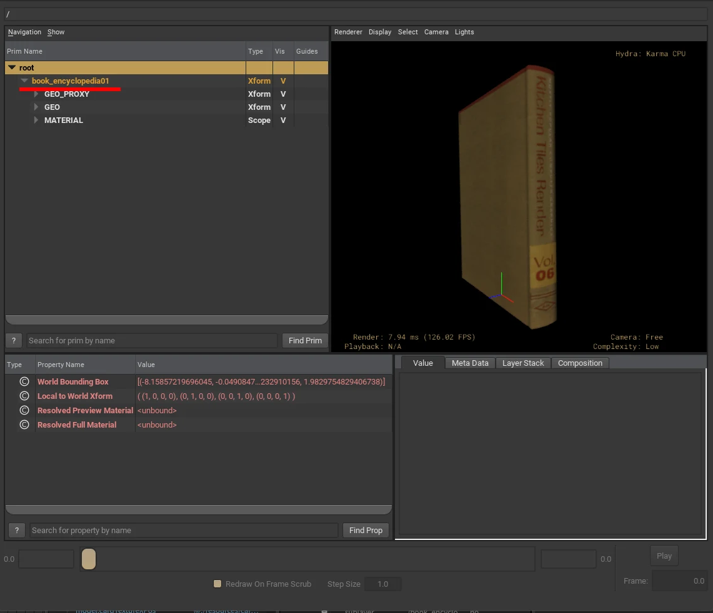
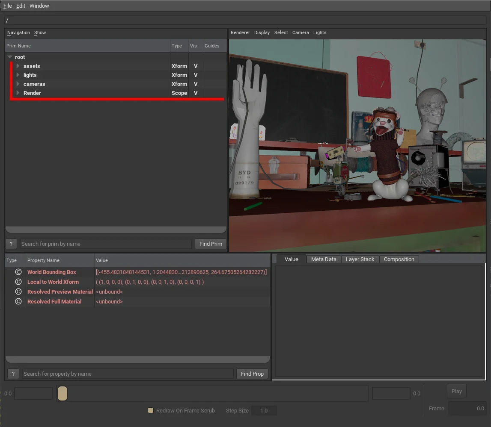
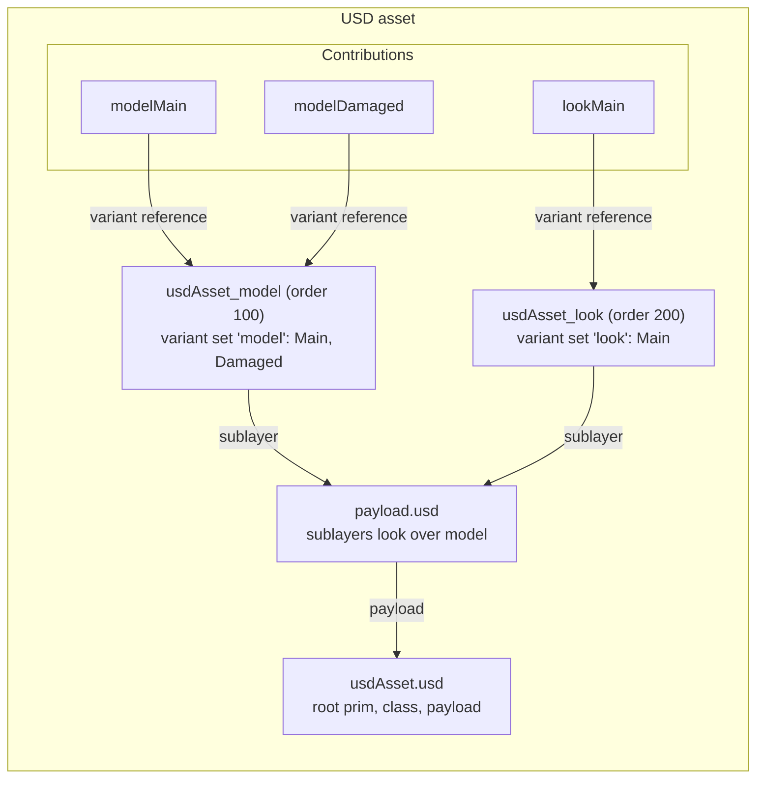
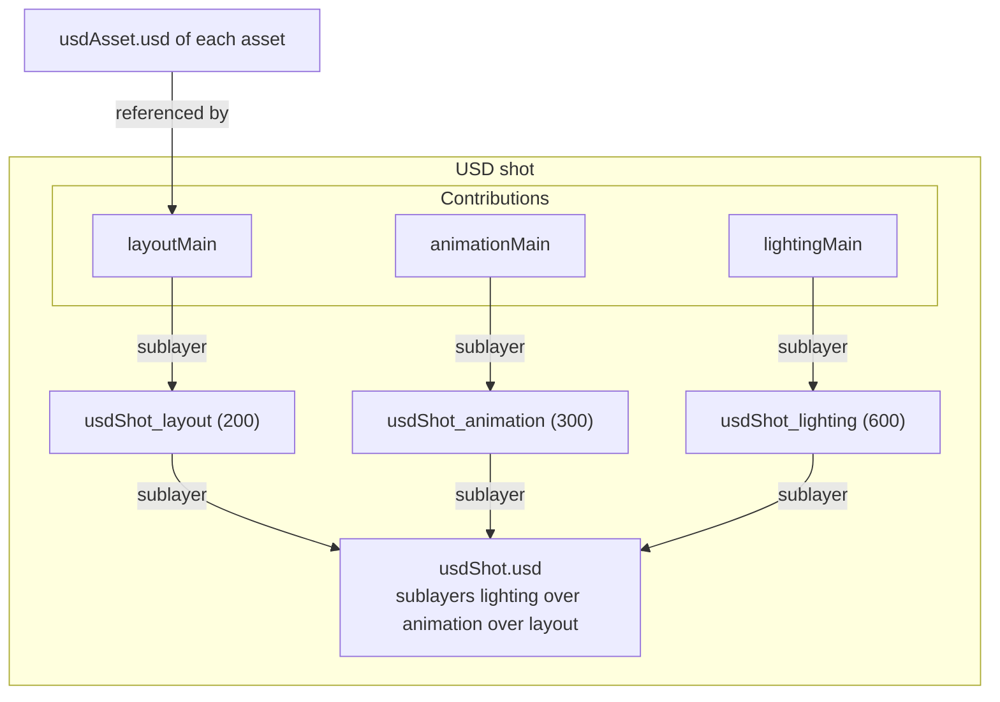
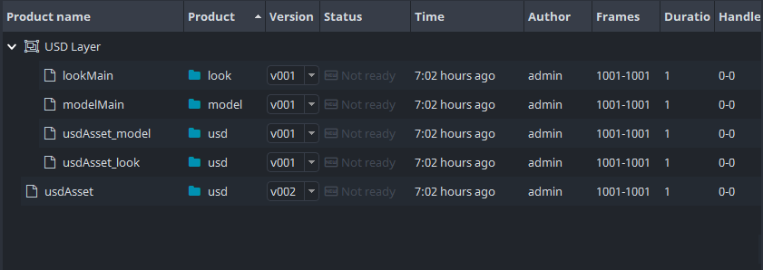
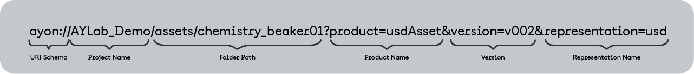

# OpenUSD

OpenUSD (Universal Scene Description) is the scene description format that AYON uses to exchange assets and shots between departments and applications. 

AYON adds two things on top of it: 
- the **USD contribution workflow** in the Core addon, which turns ordinary department publishes (a model, a look, a layout, a lighting pass) into layers of one asset or shot USD file without the artist authoring USD composition by hand.
- and the **AYON USD resolver** in the USD addon, which lets USD files point to published versions through `ayon://` entity URIs instead of fixed file paths. The workflow is the same in every application that supports it, within the limits of each application's own USD support.

## Why the USD contribution workflow

The USD workflow replaces several workarounds of a traditional AYON pipeline with composition:

- **Looks.** A look is a layer over the model that targets the same prim paths. It replaces publishing the look separately and reassigning it to the geometry by IDs stored on the shapes (`cbId` in Maya, matched by the [Look Assigner](look-assigner.md)).
- **Layout and set dressing.** A layout is a layer that references the assets where they belong, so every application that reads USD opens the same result. It replaces the layout product published as a JSON file of asset references and transforms, which each application rebuilds.
- **Departments in parallel.** Each department adds its own layer instead of rebuilding what came before, and a new version of one layer reaches everyone downstream the next time the stack is opened.

The asset structure follows the [Principles of Scalable Asset Structure in OpenUSD](https://docs.omniverse.nvidia.com/usd/latest/learn-openusd/independent/asset-structure-principles.html) and the ASWF [Guidelines for Structuring USD Assets](https://wiki.aswf.io/display/WGUSD/Guidelines+for+Structuring+USD+Assets). The FMX 2024 talk [USD adoption and the AYON USD workflow](https://www.youtube.com/watch?v=1KqrIRCi_EQ) walks through the workflow.

## Assets and shots

The contribution workflow builds two kinds of target product, initialized differently. Their names are free; `usdAsset` and `usdShot` are only the defaults.

<Columns>
<Column>

**USD asset**: one root prim named after the folder, set as the default prim, with the department layers behind a payload. Brought into a scene by a reference or payload. For model, assembly, groom, look and rig.



</Column>
<Column>

**USD shot**: any root prims, such as assets, cameras, lights and render settings, with the department layers sublayered directly. Brought into a scene as a sublayer, or opened as the root layer. For layout, animation, simulation, fx and lighting.



</Column>
</Columns>

*Both examples are from the [ALab](https://dpel.aswf.io/alab/) data set by Animal Logic.*

:::note Root prim of an asset
The root prim of an asset takes the folder's **name**, not its label: the folder *Book Encyclopedia 01* has the root prim `book_encyclopedia01`. Everything an asset contribution publishes has to sit under that prim, otherwise a reference to the asset finds nothing. A name that starts with a digit gets an underscore in front (`_01_prop`), since prim names cannot start with a digit.
:::

## The contribution workflow

The contribution workflow is a set of Core publish plugins that run for every instance of the `usd` family (`Collect USD Layer Contributions` and the two `Extract USD ... Contributions` plugins). When **USD Contribution** is enabled on an instance in the [Publisher](publisher.md), one publish produces three levels of products:

1. **The contribution**: the artist's own product, for example `modelMain` or `lookMain`, exported by the application.
2. **The department layer**: a product named `<target product>_<department layer>`, for example `usdAsset_model`. It holds every contribution made to that department, either as variants or as sublayers.
3. **The target product**: for example `usdAsset` or `usdShot`. It sublayers the department layers in their configured order.

<Columns widths="45 55">
<Column>


</Column>
<Column>


</Column>
</Columns>


The department layer and target product instances are created automatically during collection, so the artist only ever creates the contribution. They get the product type `usd` and always increment from their own last version instead of following the workfile version, so that contributions from different scenes never collide. Contributions and department layers are grouped under **USD Layer** in the Loader.



### Publish options

<!-- screenshot: the USD Contribution section of the Publisher with Enable, Target product, Initialize as, Add to department layer, Strength order, Add as variant, Variant Set Name, Variant Name and the "Set as default variant selection" dropdown -->

<Settings prefix="usd-contribution">
<Setting name="Enable">

Whether this instance becomes a contribution at all. When off, the product is published as a standalone USD file.

</Setting>
<Setting name="Target product">

The product the department layer goes into, usually `usdAsset` or `usdShot`. It is created if it does not exist yet.

</Setting>
<Setting name="Initialize as">

`asset` or `shot`: the structure used when the target product is created for the first time, and which department layers are offered. It has no effect once the target product exists.

</Setting>
<Setting name="Add to department layer">

The department layer. The list comes from the department layer orders in the Core settings, filtered by the **Initialize as** scope.

</Setting>
<Setting name="Strength order">

An offset inside the department layer, for when several contributions target the same layer (for example a proxy that should be weaker than the main model). Higher is stronger.

</Setting>
<Setting name="Add as variant">

On: the contribution is referenced into a variant on the asset's root prim. Off: it is sublayered into the department layer. Contributions to shots usually have it off.

</Setting>
<Setting name="Variant Set Name, Variant Name">

Default to `{layer}` and `{variant}`: the variant set is named after the department layer and the variant after the instance variant. Other instance data keys can be used too.

</Setting>
<Setting name="Set as default variant selection">

`Set as default if no current default` (default), `Set as default` or `Do not set`. With several contributions set to always become the default, the strongest order wins.

</Setting>
</Settings>

**Department layer profiles** in the Core settings prefill these options per product type, task type and task name. With the default settings, `model`, `look`, `groom` and `rig` products contribute to `usdAsset` as variants of the department layer of the same name, and `animation` products contribute to the `animation` layer of `usdShot` without a variant. A product type without a profile starts with contribution enabled, target `usdAsset`, no department layer selected and no variant.

### How layers stack

Every department layer has an **order**; a higher order is a stronger layer and is placed above the others. The default orders are:

| Asset scope | Order | Shot scope | Order |
|---|---|---|---|
| model | 100 | layout | 200 |
| assembly | 150 | animation | 300 |
| groom | 175 | simulation | 400 |
| look | 200 | fx | 500 |
| rig | 300 | lighting | 600 |

Admins can add, remove and reorder layers and give each one the `asset` scope, the `shot` scope or both. A department that works on assets and on shots (animation, for example) is better served by two differently named layers, such as `assetAnim` and `shotAnim`, so that an asset and a shot mixed in one stage do not stack in unexpected ways. AYON does not validate whether a department layer is used with the intended target product or whether its content fits the department, so studios should agree on which layer holds what.

The order is stored in the published files themselves: as `layer_id` and `order` arguments on each sublayer path, and as `ayon_order` and `AYON_layer_id` custom data on each reference. A later publish reads them back, so a new contribution is inserted at the right place even when the settings changed in the meantime.

### Building on the last version

Each publish opens the **latest version** of the department layer and of the target product and adds to it; it does not rebuild them from scratch. This is what lets departments publish independently:

- A new variant is added to the existing variant set; the other variants stay.
- A contribution is identified by its product name. Publishing the same product again replaces its previous entry, also when it moves to another variant or switches between variant and sublayer. A variant left empty by such a move is removed.
- When nothing changed compared to the last version, the department layer or target product is not published again.
- On first creation of the target product, the frame rate of the publish is written to it. Later publishes with a different frame rate log a warning.

The flip side is that USD contributions are additive. A contribution or a department layer that is no longer wanted does not disappear by publishing without it. For example, an asset referenced in `usdShot` v001 is still in v002 even when it was removed from the scene. In a later layer it can be deactivated or made invisible; removing it for good means editing the published USD files by hand, see [Removing contributions](#removing-contributions).

### Removing contributions

:::danger Editing published files
Removing a contribution means opening the published `.usd` files in a text editor and deleting it by hand. A mistake leaves the file broken for every scene that uses it, and the edit changes a version that is meant to be immutable (see [Publishing](publishing.md#rules-of-a-publish)). Keep a copy of the file, and prefer deactivating or hiding the contribution in a later layer.
:::

- **A department layer from the target product.** In the `payload.usd` of an asset (or the `usdShot.usd` of a shot), delete its entry from the `subLayers` list, here the look layer:

  ```
  subLayers = [
      @.../usdAsset_look/v003/..._usdAsset_look_v003.usd:SDF_FORMAT_ARGS:layer_id=look&order=200@,
      @.../usdAsset_model/v002/..._usdAsset_model_v002.usd:SDF_FORMAT_ARGS:layer_id=model&order=100@
  ]
  ```

- **One contribution in a department layer.** In the department layer file, for example `usdAsset_model.usd`, delete the variant block of the contribution, such as `"Damaged"`. When it was the default variant, change the `variants = { string model = "..." }` selection on the root prim to another variant. To remove every contribution of the layer, delete the whole `variantSet` block and leave the root prim empty.

### Predefined contributions

**Collect Predefined USD Contributions** (off by default) adds contributions to a target product automatically on every publish, selected by profiles of task types and target product names. A predefined contribution is a sublayer, a reference at a prim path, or a reference inside a variant, and its source is either a fixed path or AYON entity URI, or a product searched in the nearest parent folder of a given folder type. A typical use is to sublayer a sequence-level `usdShot` into every shot's `usdShot`. It can be limited to sources that already exist.

### Paths written into the layers

How the department layers and target products refer to their sublayers and references is set per extractor in the Core settings:

| Mode | Written as | Needs the resolver |
|---|---|---|
| Filepath (default) | The resolved publish path | No |
| AYON Entity URI (explicit version) | `ayon://...&version=<n>` | Yes |
| AYON Entity URI as latest version | `...&version=latest` | Yes |
| AYON Entity URI as latest approved | `...&version=latestDone`: the newest version whose status is in the *done* state | Yes |

With the latest modes an asset or shot no longer pins the versions of its layers, so a new contribution shows up everywhere without republishing the asset. The department layer extractor can also force the default prim of older layers to the AYON standard (the folder name).

The settings for all of this are in the Core addon: see [USD contributions in the Core addon settings](../addons/essentials/core/settings.md#usd-contributions).

## Structure of the published files

The extractors write USD ASCII (`.usda` content in a `.usd` file).

For an asset:

```
usdAsset.usd                    defaultPrim = "<folder>", frame rate
├── /__class__/<folder>         class prim the asset inherits from
└── /<folder>                   Xform, kind = component, assetInfo
    └── payload ─> payload.usd
        payload.usd             published next to usdAsset.usd in the same version folder
        └── subLayers
            ├── usdAsset_look   (layer_id=look, order=200)
            └── usdAsset_model  (layer_id=model, order=100)
                usdAsset_model.usd   defaultPrim = "<folder>"
                └── /<folder>        variant set "model"
                    ├── variant "Main"     ─> modelMain.usd  (AYON_layer_id, ayon_order, AYON_uri)
                    └── variant "Damaged"  ─> modelDamaged.usd
```

For a shot:

```
usdShot.usd                     no default prim, frame rate
└── subLayers
    ├── usdShot_lighting        (layer_id=lighting, order=600)
    ├── usdShot_animation       (layer_id=animation, order=300)
    └── usdShot_layout          (layer_id=layout, order=200)
        usdShot_layout.usd
        └── subLayers
            └── layoutMain.usd  the artist's layer, with its referenced assets
```

- The asset file stays small: it only defines the root prim, the class and the payload. Unloading the payload unloads every department at once.
- The `/__class__/<folder>` class lets a scene override all instances of the asset at once.
- A shot is initialized as an empty layer without a default prim, and its department layers are sublayered into it directly; there is no payload.
- Each reference also stores an `AYON_uri` custom data entry with the entity URI of the contribution, so the source of a variant can be traced even when file paths are written.

The USD addon adds two optional publish plugins that change the written files: **Process USD files to use relative paths**, which anchors the asset paths of a published layer to its own location, and **Extract Skeleton Pinning JSON**, described under [Pinning](#pinning-on-the-farm). See the [USD addon](../addons/pipeline-features/usd/index.md#publish-plugins).

## The AYON USD resolver

USD finds the files behind asset paths through an *asset resolver* plugin. The AYON USD resolver is such a plugin: it resolves AYON entity URIs to the file of a published representation while the stage opens, and hands plain absolute and relative paths to the default USD resolver.



```
ayon://{project_name}/{folder_path}?product={product_name}&version={version}&representation={representation_name}
```

The scheme `ayon+entity://` is accepted as well. The version is a number (`4` or `v004`), `latest`, `latestDone` or `hero`. The resolver asks the AYON server to resolve the URI and caches the result for the session.

**Why URIs.** A file path pins one version and one storage location. An entity URI names the published representation instead:

- `version=latest` or `version=hero` keeps assets and shots up to date without republishing the files that reference them.
- The server resolves the path for the current site and its roots, so the same USD file works on Windows and Linux and in different studios.
- The URI still says which project, folder and product a layer comes from, also when someone reads the file outside AYON.

### Enabling the resolver

<SettingLocation uri="ayon+settings://usd/distribution" scope="Studio, with project overrides" />

The resolver is off until a studio turns it on. It is compiled per application version, Python version and platform, so it is not part of the addon package: the USD addon downloads or finds the build that matches the launched application and adds it to the launch environment. To enable it:

1. **Turn on Binary Distribution** in the [USD addon settings](../addons/pipeline-features/usd/settings.md#binary-distribution). Turning it off also turns off the resolver.
2. **Choose the distribution type.** `lake_fs` downloads the builds from a lakeFS server, by default the Ynput one, whose access keys (**Access Key ID**, **Secret Access Key**) are provided on request. `local` uses builds already installed in a studio folder, set in **Resolver Paths**.
3. **Map the builds to your applications.** Each entry of **Resolver Application Paths** maps a build to an application name such as `houdini/21-0`. Add the variant names of the Applications addon to its **Application Alias** list, for example `houdini/21-0-596` for a Houdini variant named `21-0-596`, so the build is used for it.

The pre-configured lakeFS list has builds for Maya 2024 to 2026 and Houdini 19.5 to 22.0 on Windows and Linux, and Unreal 5.4 on Windows. The resolver reads the server URL, API key and project from the environment AYON sets for every launched application.

Without the resolver, AYON USD files that use file paths still work; only entity URIs do not resolve. A studio that does not use entity URIs, for example to deliver self-contained USD to another studio, can keep it off, keep the contribution paths on **Filepath** and enable relative paths. Details are on the [USD addon](../addons/pipeline-features/usd/index.md#resolver-distribution) page.

<!-- screenshot: USD addon settings, Binary Distribution enabled, lakeFS settings with one Resolver Application Paths entry and its Application Alias list -->

:::caution Maya 2026.2
Maya 2026.2 ships with two USD versions, and the AYON resolver build for Maya 2026 does not resolve entity URIs with the default one. The newer USD version has to be selected for that application variant, for example with the environment variable `MULTI_USD_VERSION` set to `0.25.5` in the Applications addon.
:::

### Caching

The resolver keeps every URI it resolved in a cache shared by the whole application session, so a URI is asked from the server only once. The cache is not refreshed by itself: a URI that points to `latest` keeps the version it resolved to, even after a newer version is published. In Houdini, **Clear AYON USD Resolver Cache** in the AYON menu clears it and reloads the USD files of the LOP networks, and the AYON loader HDAs clear it for their own files when they reload. Elsewhere, restarting the application, or `ClearCache()` on the resolver context from Python, has the same effect.

### Pinning on the farm

:::note Houdini only
Automated pinning is supported only for USD renders submitted from Houdini.
:::

When hundreds of farm tasks open the same stage, live resolving sends thousands of requests to the server, and a new publish during the job could change what `latest` points to halfway through the render. **Pinning** solves both: the resolver reads a pinning file that maps every entity URI of the stage to a fixed path and does not contact the server at all.

With **Generate USD Resolver Pinning file on publish** enabled in the [USD addon settings](../addons/pipeline-features/usd/settings.md), **Extract Skeleton Pinning JSON** writes the pinning file (`<name>_pin.json`, for example `__render___pin.json`) next to the exported USD file and adds `AYON_USD_RESOLVER_ENABLE_PINNING` and `AYON_USD_RESOLVER_PINNING_FILE` to the farm job environment. A farm launch hook then maps the roots in the file to the worker's platform. Because the pinning file records what `latest` was at submission, every task renders the same versions, and an admin can retarget a broken version for the whole job by editing the pinning file instead of the USD files. See the [Deadline addon](../addons/farm-managers/deadline/index.md) for the farm side.

### Dynamic mapping

Independently of pinning, a resolver context can carry a **mapping file** that redirects URIs or paths before they are resolved, for example to swap a product, to hold `latest` at a specific version, or to point a production URI to a local test file. The file is a USD layer with a `mappingPairs` string array in its `customLayerData`, or a JSON file with a `mappingPairs` object. In Houdini it is applied as the **Resolver Context Asset** of a Configure Stage LOP.

```json
{
    "mappingPairs": {
        "ayon://my_project/assets/prop?product=usdAsset&version=latest&representation=usd": "ayon://my_project/assets/prop?product=usdAsset&version=6&representation=usd"
    }
}
```

### Troubleshooting

- **Log level.** The resolver logs warnings only by default. **Resolver Log Level**, the file logger and **AyonCppApi Logging Keys** under **AYON USD Resolver Config** (`ayon+settings://usd/ayon_usd_resolver`), and **Tf Debug Variable** under **USD Library Config** (`ayon+settings://usd/usd`, for example `AYONUSDRESOLVER_*`), give more detail.
- **Testing a URI without the application.** **Terminal** in the AYON launcher, opened for the task and the application, has the AYON environment and the resolver of that application. There `usdresolve "<URI>"` prints the resolved path, and `usdcat` and `usdview` open the resolved file.

Code-level details of the resolver are in its [repository](https://github.com/ynput/ayon-usd-resolver).

## Support per application

The contribution options and their behavior are the same everywhere, because they come from the Core addon. What differs is what each application can export as a USD layer.

| Application | Publishes USD | Loads USD | Resolver builds |
|---|---|---|---|
| Houdini | Full contribution workflow for assets and shots, plus USD renders | References, sublayers, SOP import, usdview | Yes |
| Maya | Models and edits made in a USD layer, through Maya USD (and Multiverse) | Maya USD proxy, native reference, Multiverse, Arnold standin, Redshift proxy | Yes |
| Blender | Objects converted to USD, mainly models | Imported as Blender objects | No |
| 3ds Max | Models as a USD representation | Load Model (USD) | No |
| Nuke, Fusion | No | Geometry and cameras from USD files | No |
| Unreal | No | No USD loader | Yes |

### Houdini

Houdini has the most complete support, since Solaris works natively with USD layers.

- **Creators.** The generic **USD** creator publishes any LOP output with no contribution defaults. The dedicated **USD Asset Model**, **USD Asset Look**, **USD Asset Groom** and **USD Asset Assembly** creators give their products the matching product type, so the department layer profiles prefill the options and type-specific plugins run (a USD look, for example, collects and publishes the textures it uses). **USD Component Builder LOPs** publishes a SideFX Component Builder asset, which may contain more than the selected department needs. **USD Render** publishes renders from a USD ROP, locally or on the farm, with the export and the render split into separate farm jobs if wanted.
- **Explicit layers.** Layers given a save path in the LOP network (with a Configure Layer LOP) are detected on publish and published as extra `usd` products named after the instance variant and the layer file, and the main layer's paths are remapped to them. Implicit layers are flattened into the main layer, as set by the USD ROP's save style.
- **Validation.** For contributions initialized as an asset, a validator requires the ROP's default prim to be set, and another checks that the default prim exists.
- **AYON LOP nodes.** **Load Asset (LOPs)** references a product with root prim presets: the folder name, for continuing work on that asset, or the folder path with the node name, for clean hierarchies in shots and assemblies. **Load Shot (LOPs)** sublayers a shot. **Mute Layers** mutes chosen department layers in the viewer, for example the previous looks while a new look is made; it does not change what is published. Further loaders are **Reference USD**, **Sublayer USD**, **Load USD to SOPs**, **Load filepath to node** and **Show in usdview**. The loaders can write entity URIs instead of paths.
- **Typical flow.** Load the asset or shot, add a Layer Break so the loaded layers are not written out again, author the new work, and publish it to the right department layer. Assets loaded into an assembly or layout are written into the new layer with the version they were loaded at, unless the loader writes entity URIs.
- **Scene Inventory.** Only the products loaded through AYON nodes are listed. Assets referenced inside a loaded assembly or shot are not.

See the [Houdini addon](../addons/3d-applications/houdini/index.md) for the full list of plugins and the [Loader HDAs](../addons/3d-applications/houdini/index.md#loader-hdas).

### Maya

Maya publishes through the Autodesk Maya USD plugin. Maya 2023 or later with Maya USD 0.21 or later is recommended.

- **Maya USD** exports selected Maya geometry as a USD contribution; **Maya USD: Model** does the same with the `model` product type, so the model profile and model validators apply. Both can wrap the geometry in the asset hierarchy (the root prim named after the folder) with **Create asset hierarchy**. Key export options, such as the default subdivision method, are exposed in the Publisher.
- **Maya USD Export Layer** publishes one layer of a Maya USD proxy stage as it is. This is how looks, layouts, lighting and other edits made directly in USD are contributed: load the asset or shot into a proxy, add a new layer as its edit target, author the changes under the root prim (for assets), then publish that layer. It publishes the `usd` product type, so naming the variant after the department (`lookMain`) keeps products readable. Textures referenced by such a layer are not copied along.
- **Model, pointcache and animation** publishes can also write a USD representation of their regular Maya data.
- **Loaders.** **Load USD to Maya Proxy** is the main loader for continuing work on assets and shots. **Reference Maya USD** imports USD as native Maya nodes through a reference. **Load as Arnold standin** and **Import Redshift Proxy** load USD for rendering.
- **Multiverse** has its own creators and loaders, off by default: see [Maya plugins](../addons/3d-applications/maya/plugins.md#multiverse).

See the [Maya addon](../addons/3d-applications/maya/index.md).

### Blender

Blender converts USD to Blender objects on import and back on export, and does not work with USD layers. It can therefore contribute objects but cannot extend a loaded USD layer.

- The **USD** creator publishes the selected objects as a USD contribution, mainly to the `model` department layer. **Create asset hierarchy** wraps them in the root prim named after the folder, and the extractor can convert the forward and up axes to the convention of other applications. Model products can also be extracted to USD.
- The world environment light is exported too unless it is removed from the scene.
- **Load Cache** imports a USD file as Blender objects, without variant selection.

See the [Blender addon](../addons/3d-applications/blender/index.md).

### Other applications

- **3ds Max** publishes models with an **Extract Geometry (USD)** representation and loads them with **Load Model (USD)**. See the [3ds Max addon](../addons/3d-applications/3dsmax/index.md).
- **Nuke** loads USD geometry (**Load GeoImport**, **Load GeoReference**) and cameras (**Load USD Camera**). See the [Nuke addon](../addons/compositing-editorial-applications/nuke/index.md).
- **Fusion** loads USD files with **Load USD**. See the [Fusion addon](../addons/compositing-editorial-applications/fusion/index.md).
- **Unreal** gets resolver builds from the USD addon, but the Unreal addon has no USD creators or loaders.

None of these take part in the contribution workflow, because they do not publish the `usd` product type.

## Related

- [USD addon](../addons/pipeline-features/usd/index.md) and its [settings](../addons/pipeline-features/usd/settings.md)
- [USD contributions in the Core addon settings](../addons/essentials/core/settings.md#usd-contributions)
- [Publishing](publishing.md)
- [Publisher](publisher.md)
- [Product types](product-types.md)
- [Loader](loader.md)
- [Scene Inventory](scene-inventory.md)
- [Houdini addon](../addons/3d-applications/houdini/index.md), [Maya addon](../addons/3d-applications/maya/index.md), [Blender addon](../addons/3d-applications/blender/index.md)
- [AYON USD resolver on GitHub](https://github.com/ynput/ayon-usd-resolver)
- [USD discussions on the community forum](https://community.ynput.io/tag/usd)
