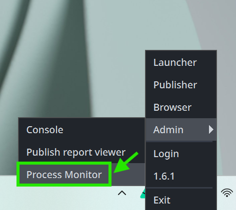
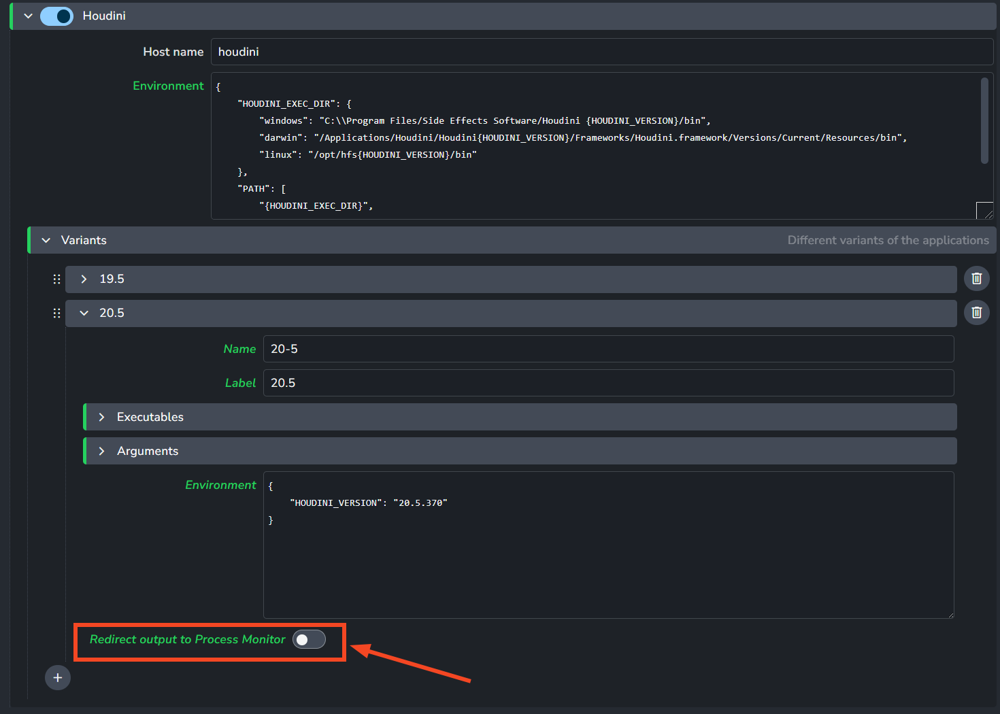

# Process Monitor

<PageInfo />

When an application started from AYON misbehaves, the first question is what it printed while it started: a launch hook that failed, a missing plugin, a Python traceback from the integration. Many applications on Windows have no console window to show that, and the output is gone once the application closes. The Process Monitor keeps it. The Applications addon redirects the standard output and error of every application it launches into a file, records the process, and this window lists those processes with their state and shows their output, also after the application has exited. TDs and pipeline support use it to read startup errors and integration logs; artists can copy from it when reporting a problem.

## Where it appears

**Process Monitor** is an entry in the **Admin** submenu of the AYON tray menu. The Applications addon adds it as an admin action of the tray; the core tray adds **Console** and **Publish report viewer** to the same submenu, which appears only when at least one addon adds an action to it. See [Tray and Launcher window](tray-and-launcher-window.md) for the tray menu.

The window title is `AYON Process Monitor`, a dialog with a minimum size of 1000 by 600 pixels. There is one window; closing it stops its background refresh and showing it starts it again.

## Layout

<!-- screenshot: the AYON Process Monitor window with several launched applications in the process tree (running and stopped icons), one row double-clicked and its output in the Output Content pane -->

| Region | Content |
|---|---|
| Toolbar | Buttons **Refresh Process List**, **Clean Inactive**, **Delete Selected**. |
| Process tree | Table of recorded processes with an expandable list of child processes under each. |
| Output pane | Label **Output Content:**, the output text, and the checkbox **Auto-reload output for running processes**. The pane is below the tree (the tree gets about 60% of the height). |
| Status bar | Short messages: `Ready`, `Loaded N processes`, deletion results and errors. |

### Process tree

| Column | Content |
|---|---|
| **Name** | Name of the launched application, with a state icon. |
| **Executable** | Path of the executable. |
| **PID** | Process id, or `N/A`. |
| **Created** | When the record was created, in local time. |
| **Start Time** | When the process started, in local time. |
| **Output File** | Path of the file that holds the redirected output, or `N/A`. |

The table is sorted by **Created**, newest first, and any column can be sorted. Selection is extended (Ctrl and Shift).

Child processes started by an application are listed under its row, in italics. They carry the running state icon. Child processes are tracked for processes that are not marked stopped.

State icons:

| Icon | State |
|---|---|
| Green circle | The process is running. |
| Yellow circle | The main process has ended but some of its child processes still run. |
| Red circle | The process has stopped. |
| Gray circle | State not known yet. |

The list refreshes continuously in a background thread: new launches appear, states and child processes update, and records that were deleted elsewhere disappear.

## Controls

| Control | What it does |
|---|---|
| **Refresh Process List** | Reloads the list of recorded processes immediately. |
| **Clean Inactive** (tooltip "Remove all inactive processes from database") | After a confirmation, deletes the records of all stopped processes together with their output files, then refreshes. The status bar reports the number deleted. |
| **Delete Selected** (tooltip "Delete selected process from database and its output file") | After a confirmation, deletes the selected processes and their output files. The Delete key does the same. Child process rows cannot be deleted; selecting only child rows shows "Cannot delete a descendant process from DB." With no selection a notice asks to select a process. |
| Double-click on a main process row | Loads the content of its output file into the output pane. Child rows ignore the double-click. |
| **Auto-reload output for running processes** (on by default) | For a running process, the output pane follows the file: it watches the file for changes and also reloads it every 2 seconds. Turning it off stops the updates. The view keeps its scroll position, or stays at the end when it was at the end. |

The output pane renders ANSI color codes as colors. Its placeholder reads "Double-click a process row to view its output file content...". Other texts it can show: "No output file available" when a process has no output file, "Output file not found" when the file was removed, "Output file is empty", and "Loading file content...".

## Where the data comes from

| Item | Behavior |
|---|---|
| Process records | Stored in a SQLite file `process_handlers.db` in the launcher local folder, shared by all AYON launches of the same user. Each record holds name, executable, arguments, environment, working folder, PID, start time, output file and a stopped flag. |
| Output file | A temporary text file named `ayon_<host name>_output_<random>.txt`. Standard output and error of the application are both written to it. |
| State | A process counts as running while a process with the recorded PID exists, its creation time matches the recorded start time (within one second) and its executable matches the recorded one. A process that fails the check is marked stopped in the database. |

## Tool settings

Tool settings are set in the studio settings and can be overridden per project. The monitor itself has no settings; it shows the records of the current OS user's launcher folder. Whether an application's output reaches it is set per application variant with **Redirect output to Process Monitor** in the [Applications addon settings](../addons/essentials/applications/settings.md#variant) (on by default). With it off, the process is still listed, but without an output file ("No output file available").

## FAQ

### Why is the console window of Houdini empty?

While the output of an application goes to the Process Monitor, it does not appear in the application's own console window, so applications that have one, such as Houdini, open it empty or not at all. To get the native console back, turn off **Redirect output to Process Monitor** on that application variant.

## Related

- [Tray and Launcher window](tray-and-launcher-window.md): starts the applications that appear here, and holds the Admin submenu.
- [AYON launcher](launcher.md): the desktop application whose local folder holds the process records.
- [Applications addon](../addons/essentials/applications/index.md) and its [settings](../addons/essentials/applications/settings.md): application variants and the redirect setting.
- [Publisher](publisher.md): the Details tab and the tray's **Publish report viewer** show publish logs, a separate tool in the same Admin submenu.
