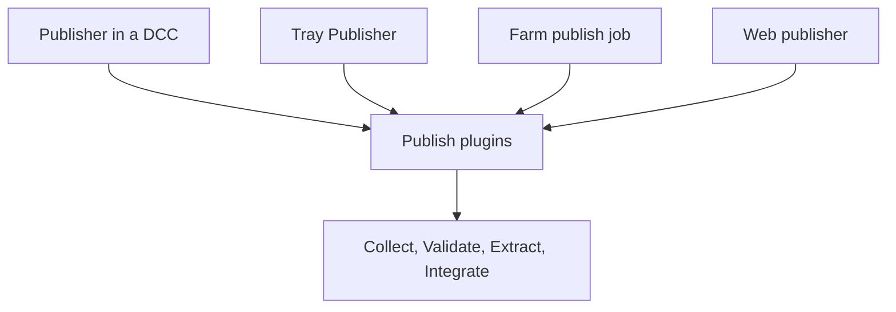

import trace from "@site/src/data/flows/publishing-stages.json";

# Publishing

Publishing turns work in progress into a shared, versioned and registered result. An artist selects what to share, AYON checks it, writes the files, stores them in the project's publish folder and registers them on the AYON server, so that other artists and tools can find and load them. A publish is the checkpoint between one person's work and the next person in the pipeline: problems are caught before they travel downstream, and nobody has to dig through someone else's work files to find the right model or camera.

Publishing takes a little time up front and saves much more later. Everything downstream in AYON builds on it: the [Loader](loader.md) and the [Scene Inventory](scene-inventory.md) work with published versions, review media is made during the publish, and the production tracking side sees each publish as a new version linked to its task.

## What a publish produces

Each publish of a product creates a new **version** of it, for example `v003` of `modelMain`, and the version holds one **representation** per file format, for example `abc` and `ma`. The entities are described in [Entities](../ayon/how-ayon-works/entities.md), the kinds of products in [Product types](product-types.md), and how names, version numbers and paths are built in [Naming conventions](naming-conventions.md).

## Rules of a publish

- **Clear naming.** Product names, folder names and file names follow the studio's naming conventions, set in the project anatomy and the Core addon settings.
- **Versioned.** Every publish creates a new version number. Selected product types also keep a hero version, an unversioned copy of the latest version.
- **Immediately usable.** A published version does not depend on unpublished files or work directories. Dependencies such as textures are copied along as resources of the version.
- **Immutable.** A published version is not changed afterwards. A change is published as the next version. The validator **Validate Version** stops a publish that would write to an existing or older version number.
- **Location from the anatomy.** Published files are stored in a folder derived from the folder, the product and the version, according to the publish templates of the project anatomy.

## Instances and creators

A publish has two phases. The **Create** phase defines *what* is published: a **creator** plugin of the host integration makes a **publish instance**, a record with a product type, a variant, a target folder and task and the creator's options. The instance is stored in the workfile, so it is created once and published again and again. Automatic creators add some instances by themselves, such as the `workfile` instance most hosts keep. The **Publish** phase then runs the publish stages on the instances.

Artists do both in the [Publisher](publisher.md). Developers find the creator API in [Host integration](../developer/addon-development/host-integration.md).

### Where instances live

Each host integration decides where the instance data is stored. AYON does not otherwise change the scene structure or content.

| Host | Where the instance data is stored |
|---|---|
| Maya | A set that contains the selected objects, with AYON attributes on the set. |
| Nuke | A write node with the selection connected as input, with the data in a hidden knob. |
| Hiero, DaVinci Resolve, Flame | A tag or marker on the clip in the timeline, with the data in its metadata. |
| Tray Publisher | The publisher session itself, with the files chosen by the artist. |

## The publish stages

Publishing is built on [Pyblish](https://learn.pyblish.com/), a plugin framework in which every plugin belongs to one stage and runs in the order of its number. AYON adds the Create phase in front of it and the Publisher window around it. The plugins come from the Core addon, which provides the stages shared by all hosts, and from the host and feature addons. Plugins can be switched on, off or made optional in the addon settings; see [Core addon settings](../addons/essentials/core/settings.md#publish-plugins).

### Explore the stages

Selecting a stage shows what it does, what remains afterwards and whether it runs on every publish. The plain-text version under the chart repeats the same information.

<FlowTrace data={trace} />

The integrator writes the product and version records to the server before it copies any file, so parallel publishes do not take the same version number. If a copy fails, the files already copied are rolled back.

### What exists where

| After stage | In the scene or session | In the staging directory | In the publish folder | On the AYON server |
|---|---|---|---|---|
| Create | Instances with their data. | Nothing. | Nothing. | Nothing. |
| Collect | Instances with full data. | Resolved, not yet written. | Nothing. | Unchanged. Entities and the latest version are read. |
| Validate | Unchanged. | Unchanged. | Nothing. | Unchanged. |
| Extract | Unchanged. | Representation files, review media, thumbnails. | Nothing. | Unchanged. |
| Integrate | Unchanged. | Removed after a successful publish (unless persistent). | Versioned files and resources, hero version files. | Product, version and representation records, thumbnail, reviewables, input links, hero version. |

## Where the published files go

### Staging directory

Extractors write to a staging directory first. By default it is a new temporary folder (inside the folder of the `AYON_TMPDIR` environment variable when set). Some hosts write to their own location, for example renders, and the Core setting **Custom Staging Dir Profiles** can point chosen products to an anatomy staging template, optionally persistent so the files are kept after the publish. See [Staging directories](naming-conventions.md#staging-directories).

### Publish directory or in place

The integrator chooses a publish template of the project anatomy with the Core setting **Template name profiles** and fills it with the context, product and version. The default templates store each version in its own folder below the folder's `publish` directory, for example `.../sh010/publish/plate/plateMain/v003/`. The `render` template is used for renders and reviews, and the `online` template, used by the Tray Publisher's Online creator, keeps the original file names.

Publishing **in place** is the exception. The anatomy's `source` publish template uses the key `originalDirname`: files that already sit in their final location inside a project root are registered where they are, with their own names, instead of being copied into a version folder. The validator **Validate publish dir** stops such a publish when the files are outside every project root. No default profile selects the `source` template; a studio adds a profile for the products that should publish in place, for example large plates that are already on the project storage. Template keys and profiles are described in [Publish](naming-conventions.md#publish).

### Hero versions

A hero version is an unversioned copy of the latest published version, stored in a folder without a version number, so scenes can reference one stable path and always get the latest publish. It is made by the optional plugin **Integrate Hero Version** for the product types listed in its settings. See [Hero versions](naming-conventions.md#hero-versions).

### Version numbers

A new publish normally gets the latest version of the product plus one. A studio can instead publish with the version number of the workfile, so that `v012` of the scene publishes `v012` of its products:

- **Collect Version from Workfile** lists the hosts that read the version from the workfile name.
- **Follow workfile version** in **Collect Anatomy Instance Data** applies it to every product of those hosts.
- The Nuke addon can apply it to chosen product base types only, with **Collect Sync Workfile Version** in its [publish settings](../addons/compositing-editorial-applications/nuke/settings.md#collectors). The global Core option overrides this list.

The order in which the version number is chosen is described in [Version numbers](naming-conventions.md#publish).

## Review media

During a publish, the Core addon turns the frames or movie a host produced (a playblast, a flipbook, a render, a plate) into review media that plays in the browser and in review tools, with consistent color and burnins. The steps are Pyblish plugins that run on the representations of an instance:

1. **Media from the host.** The host writes an image sequence or a movie, such as a playblast or a render.
2. **Transcode color spaces** (`ExtractOIIOTranscode`) converts the colorspace with OpenImageIO, for example from scene linear to a display colorspace. It is redundant when the host already writes display-referred output with OCIO, and essential for output that is not color managed. See [Color management in publishing](color-management-in-publishing.md).
3. **OIIO Post Process** (`ExtractOIIOPostProcess`) runs further `oiiotool` operations, such as resizing or cropping, for matching profiles.
4. **Extract Review** (`ExtractReview`) encodes the review outputs with FFmpeg, for example an H.264 `mp4`, as new representations.
5. **Extract Burnin** (`ExtractBurnin`) overlays text such as the frame number, the shot name or the date onto the review movie with FFmpeg.

Other addons can add steps. The [Slater](../addons/pipeline-features/slater/index.md) addon, for example, adds a slate frame before the review is encoded. The thumbnail of the version is made from the same media by **Extract Thumbnail**.

The review representations are published to the studio storage like any other representation. A representation tagged `webreview` is also uploaded to the AYON server by **Integrate AYON Review**, which makes it a [reviewable](../ayon/web-ui/details-panel.md#version-files-tab) that plays in the [web viewer](../ayon/web-ui/web-viewer.md) and in review sessions. The default `h264` and `png` outputs of Extract Review carry this tag. The outputs, tags, burnins and profiles are set in the [Core addon settings](../addons/essentials/core/settings.md#extract-review).

:::note
A reviewable on disk is not always on the server. When a version has review files but the web app shows no reviewable, the representation was published without the `webreview` tag, or the upload failed.
:::

A version can also get a reviewable without the pipeline, by [uploading a file](../ayon/web-ui/dialogs/upload-version.md) in the web app. Such an upload is used as it is: no transcoding, color conversion or burnins are applied.

## Entry points

The same stages run from different entry points. The plugins differ in what the host and the addon provide.

| Entry point | How instances come to exist |
|---|---|
| Publisher in a DCC | Creators of the host addon (Maya, Nuke, Houdini, Blender and others) store instances in the workfile. The artist publishes interactively and can stop, validate only and fix problems. |
| [Tray Publisher](../addons/essentials/traypublisher/index.md) | Creators make instances from files the artist picks (plates, images, models, edit files, CSV lists and others), without a DCC. |
| Farm publish job | A job on the render farm publishes what a DCC submitted, see below. |
| [Web publisher](../addons/pipeline-features/web-publisher/index.md) | A user uploads files in the web app and a background service publishes them headless, for example for freelancers without access to the studio storage. |

Publishing from an edit, which creates shots as well as products, is described in [Editorial publishing](editorial-publishing.md).

## Farm publishing

Heavy outputs, such as renders, caches or long playblasts, can be produced on a render farm. The workstation then collects, validates and submits jobs, and a publish job on the farm runs the remaining extraction and integration once the render is done, so the result is registered as a normal version. See [Farm](farm.md).

## Skipping and partial publishes

| Mechanism | Effect |
|---|---|
| Optional plugin | A plugin marked optional shows a checkbox in the instance's publish attributes. When it is off, the plugin does nothing for that instance. Integrate Hero Version is an example. |
| Disabled plugin | A plugin switched off in the addon settings is skipped and reported as skipped. |
| Targets | A plugin limited to targets runs only for those, for example the collector of farm-rendered files only for `farm`. |
| Instance data | `publish` false skips an instance. `integrate` false extracts it without registering it. `farm` true defers integration to the farm job. |

Artists also switch instances off, stop a publish or only validate in the [Publisher](publisher.md).

## Related

- [Product types](product-types.md)
- [Publisher](publisher.md)
- [Naming conventions](naming-conventions.md)
- [Color management in publishing](color-management-in-publishing.md)
- [Editorial publishing](editorial-publishing.md)
- [Farm](farm.md)
- [Core addon settings](../addons/essentials/core/settings.md)
- [Tray Publisher](../addons/essentials/traypublisher/index.md)
- [Host integration](../developer/addon-development/host-integration.md) (developer)
