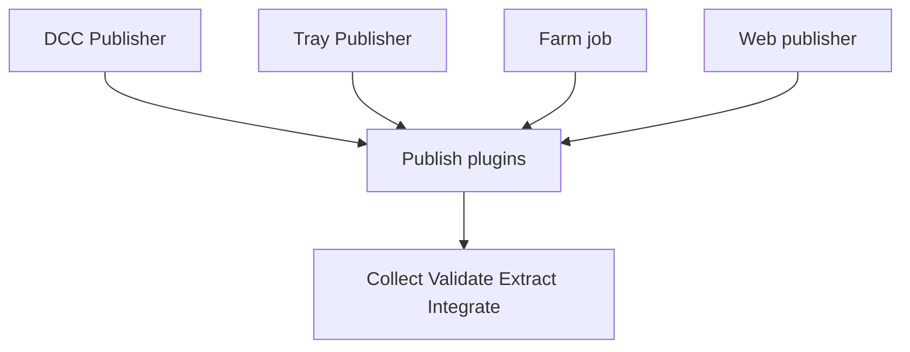

import trace from "@site/src/data/flows/publishing-stages.json";

# Publishing

Publishing turns work in progress into a shared, versioned and registered result. An artist selects what to share, AYON checks it, writes the files to a staging directory, copies them to the project's publish folder and registers the result on the AYON server so that other artists and tools can find and load it. A publish is the checkpoint between one person's work and the next person in the pipeline: problems are caught before they travel downstream.

The unit of a publish is the **product**: a named piece of work such as a model, a camera or a rendered sequence. Each publish of a product creates a new **version** of it. A version holds one or more **representations**, the actual files in a given format. The category a product belongs to is its [product type](product-types.md).

## Rules of a publish

| Rule | Meaning |
|---|---|
| Clear naming | Product names, folder names and file names follow the studio's naming conventions, which are set in the project anatomy and in the Core addon settings. See [naming conventions](naming-conventions.md). |
| Versioned | Every publish creates a new version number. Versions are not overwritten. Selected product types also keep a hero version (see below). |
| Immediately usable | A published version does not depend on unpublished files or on work directories. Dependencies such as textures are copied along as resources. |
| Immutable | A published version is not modified. A change is published as the next version. |
| Location from the anatomy | Published files are stored in a folder derived from the folder (asset, shot, sequence), the product and the version, according to the publish templates of the project anatomy. |

## How publishing works

A publish has two phases. The **Create** phase defines what is published. The **Publish** phase processes it through four stages: **Collect**, **Validate**, **Extract** and **Integrate**. Publishing is built on Pyblish, a plugin framework in which every plugin belongs to one stage and runs in the order of its number. AYON adds the Create phase in front of it and the Publisher window around it.

| Stage | What it does | What remains | Runs on every publish |
|---|---|---|---|
| Create | Defines what to publish: a publish instance for a selection, node, clip or scene, with a product type and a name. | The instance stays in the scene (or in the publisher session). | No. Created once, edited when needed. |
| Collect | Gathers data from the host, the AYON server and the instances. | Nothing. | Yes. |
| Validate | Checks the data and content against the studio's rules and stops the publish on errors. Some checks offer a repair. | Nothing, unless a repair changes the scene. | Yes, and again after each fix. |
| Extract | Exports the instances to files in a staging directory, with reviewables and thumbnails. | Files in the staging directory, deleted after the publish. | Yes. |
| Integrate | Copies the files to the publish folder and registers the version on the AYON server. | A new version on disk and on the server, permanent. | Yes. Every publish is a new version. |

An artist usually meets Create once per product and then publishes again and again: the four publish stages start from nothing each time and read the instances that Create left in the scene.

## Explore the stages

Selecting a stage shows what it does, what remains afterwards and whether it runs on every publish. The plain-text version under the chart repeats the same information.

<FlowTrace data={trace} />

## What exists where

| After stage | In the scene or session | In the staging directory | In the publish folder | On the AYON server |
|---|---|---|---|---|
| Create | Instances with their data. | Nothing. | Nothing. | Nothing. |
| Collect | Instances with full data. | Created when resolved. | Nothing. | Unchanged. Entities and the latest version are read. |
| Validate | Unchanged. | Unchanged. | Nothing. | Unchanged. |
| Extract | Unchanged. | Representation files, reviewables, thumbnail files. | Nothing. | Unchanged. |
| Integrate | Unchanged. | Deleted after a successful publish (unless persistent). | Versioned files and resources, hero version files. | Product, version and representation records, thumbnail, reviewables, input links, hero version. |

### Where instances live

Each host integration decides where the instance data of the Create phase is stored. The scene is not otherwise changed.

| Host | Where the instance data is stored |
|---|---|
| Maya | A set that contains the selected objects, with AYON attributes on the set. |
| Nuke | A write node with the selection connected as input, with the data in a hidden knob. |
| DaVinci Resolve | A marker on the clip in the timeline, with the data in the marker notes. |
| Tray Publisher | The publisher session itself, with the files chosen by the artist. |

### Staging directory

The staging directory is the temporary location the extractors write to. It is resolved in this order: a value already set on the instance (some hosts write to their own location), then a matching profile of the Core addon setting **Custom Staging Dir Profiles**, then a new temporary folder created inside the folder of the `AYON_TMPDIR` environment variable when set, and in the system temporary folder otherwise.

### Publish folder and hero versions

Integrate chooses the publish template with the Core setting **Template name profiles** and stores the files in the folder that the project anatomy derives from the folder, product and version. See [naming conventions](naming-conventions.md). The product and version records are registered on the server before any file is copied, so parallel publishes do not reuse a version number, and the copied files are rolled back on an error.

A hero version is an unversioned copy of the latest published version. It is a version with the negative of the source version number and its own folder without a version in the path, so scenes can reference one stable path and always get the latest publish. It is created by an optional plugin for the product types listed in its **Families** setting.

## The artist's view

The stages above are the developer's structure. An artist meets them as a few visible steps in the Publisher (see [publisher](publisher.md)) and does not need the stage names.

| Step in the Publisher | What the artist sees | Underlying stage |
|---|---|---|
| **Create** tab | The list of creators (product types), a variant, the folder and task, and the **Create** button. Created instances appear in the instance list. | Create phase. |
| **Publish** tab | The instances with an active toggle each, and their attributes, including the attributes of optional plugins. | Before Collect. |
| **Publish** button (play icon) | A progress bar with the instance and plugin being processed. The footer also has **Save**, **Reset**, **Stop** and **Validate** buttons and a comment field. | Collect, Validate, Extract, Integrate. |
| **Validate** button | Runs the publish up to the end of validation, then pauses. | Collect and Validate. |
| Validation errors | The message "Your publish didn't pass studio validations", with the errors grouped by plugin, the affected instances, a description and the plugin actions (for example repair). The publish cannot continue until the errors are fixed. | Validate. |
| Finished or error | "Finished" on success. "Error happened" for a crash, with a "This is not your fault" page and options to copy or save the report. | Any stage. |
| **Report** tab | Instances, plugins and the log of each, available after the publish stops. | Report. |
| **Details** tab | The publish report viewer. | Report. |

### Entry points

The same stages run from different entry points. The plugins differ in what the host and the addon provide.

| Entry point | How instances come to exist | Notes |
|---|---|---|
| DCC Publisher | Creators in the host (Maya, Nuke, Houdini, Blender and others) store instances in the scene. The Publisher window runs all four stages with the target `local`. | Interactive. The artist can stop, validate only and fix problems. |
| Tray Publisher | The Tray Publisher addon creates instances from files the artist picks (plates, images, editorial, audio, models and others). No DCC is involved. See [Tray Publisher](../addons/essentials/traypublisher/index.md). | The host name is `traypublisher`. |
| Farm publishing | A host plugin submits a job (Deadline, Royal Render, OpenCue). The job runs `ayon publish` on a JSON file with the target `farm`. Collect Rendered Files reads the files from the path in `AYON_PUBLISH_DATA`, then validation, extraction and integration run headless with the `shell` host. | Instances are flagged `farm` in the local publish, so the local Integrate Asset skips them. |
| Web publisher | The Webpublisher addon lets a user upload files in the web app. A background service starts a headless publish with its own host (`webpublisher`) for the uploaded batch. | Intended for freelancers without access to studio storage. |

### Skipping and partial publishes

| Mechanism | Effect |
|---|---|
| Instance toggle | Each instance has an active toggle in the Publisher. An inactive instance is not collected and none of its plugins run. Child instances can follow the toggle of their parent. |
| Optional plugin | A plugin that uses `OptionalPyblishPluginMixin` and has `optional` set shows an `active` checkbox (labeled with the plugin name) in the attributes of the instance. When it is off the plugin does nothing for that instance. Examples: Integrate Hero Version and Validate Version. |
| Inactive or disabled plugin | A plugin with `active` false, or `enabled` false (usually set from the addon settings), is skipped and reported as skipped. |
| Targets | A plugin with a `targets` list runs only for those targets, for example Collect Rendered Files only for `farm` and `filesequence`. |
| Per instance data | `publish` false skips an instance. `integrate` false extracts it but does not register it. `farm` true defers integration to the farm job. |
| Stop and Validate | **Stop** pauses a publish and **Publish** continues it. **Validate** stops after validation. |

## Related

- [Product types](product-types.md)
- [Publisher](publisher.md)
- [Naming conventions](naming-conventions.md)
- [Color management in publishing](color-management-in-publishing.md)
- [Core addon settings](../addons/essentials/core/settings.md)
- [Tray Publisher](../addons/essentials/traypublisher/index.md)
