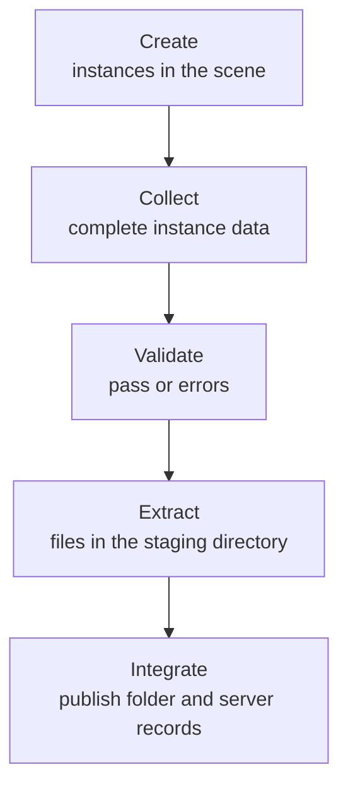
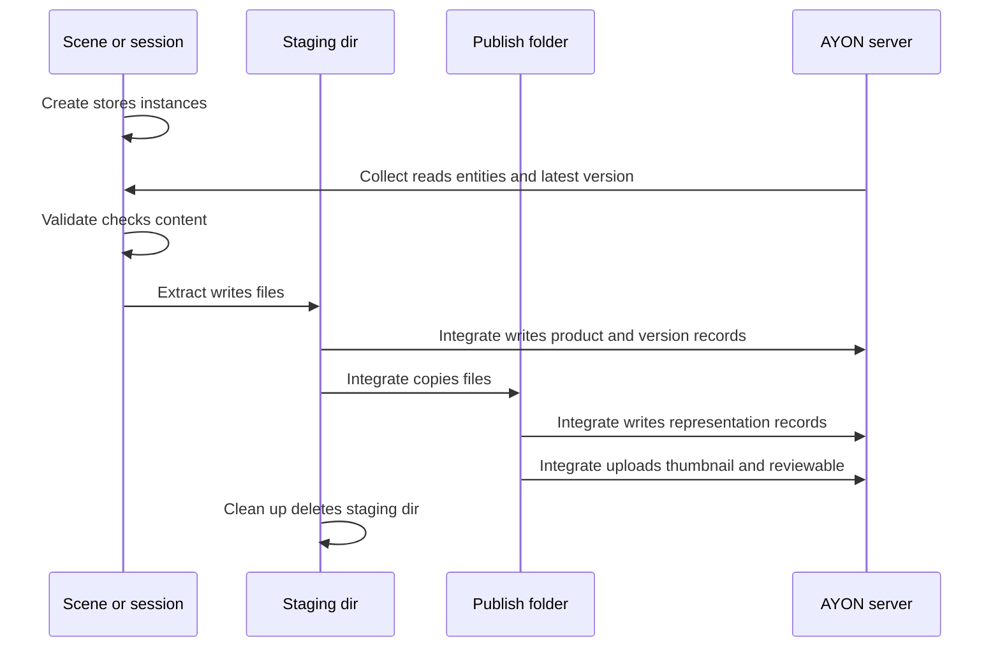
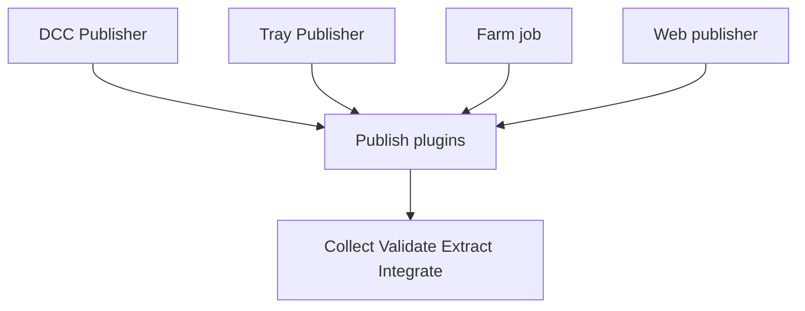

# Publishing

Publishing turns work in progress into a shared, versioned and registered result. An artist selects what to share, AYON checks it, writes the files to a staging directory, copies them to the project's publish folder and registers the result on the AYON server so that other artists and tools can find and load it. A publish is the checkpoint between one person's work and the next person in the pipeline: problems are caught before they travel downstream.

The unit of a publish is the **product**: a named piece of work such as a model, a camera or a rendered sequence. Each publish of a product creates a new **version** of it. A version holds one or more **representations**, the actual files in a given format. The category a product belongs to is its [product type](product-types.md).

## Rules of a publish

| Rule | Meaning |
|---|---|
| Clear naming | Product names, folder names and file names follow the studio's naming conventions, which are set in the project anatomy and in the Core addon settings. See [naming conventions](naming-conventions.md). |
| Versioned | Every publish creates a new version number. Versions are not overwritten. Selected product types also keep a hero version (see below). |
| Immediately usable | A published version does not depend on unpublished files or on work directories. Dependencies such as textures are copied along as resources. |
| Immutable | A published version is not modified. A change is published as the next version. |
| Location from the anatomy | Published files are stored in a folder derived from the folder (asset, shot, sequence), the product and the version, according to the publish templates of the project anatomy. |

## How publishing works

Publishing is built on Pyblish, a plugin framework in which every plugin has a numeric **order** and runs in order of that number. AYON extends Pyblish with its own base classes, a Create step in front of it and a UI (the Publisher) around it. A publish has two phases.

| Phase | Purpose | Result |
|---|---|---|
| Create | Defines what is published. | One or more **publish instances** stored in the scene (or in the publisher session for hosts without a scene). |
| Publish | Processes the instances through four stages. | Files in the publish folder and records on the AYON server. |

### Create phase

Creator plugins turn a selection, a node, a clip or a whole scene into a publish instance. An instance carries the product type, the product name (built from a template, the variant and the context), the folder path, the task, an active flag and the attribute values the artist can edit. Each host integration decides where the instance lives:

| Host | Where the instance data is stored |
|---|---|
| Maya | A set that contains the selected objects, with AYON attributes on the set. |
| Nuke | A write node with the selection connected as input, with the data in a hidden knob. |
| DaVinci Resolve | A marker on the clip in the timeline, with the data in the marker notes. |
| Tray Publisher | The publisher session itself, with the files chosen by the artist. |

Creation does not change the scene content. The creator base classes in `ayon_core.pipeline.create` are:

| Base class | Use |
|---|---|
| `Creator` | Creator the artist picks in the Publisher. Defines default variants, description, pre-create attributes and the instance attribute definitions. |
| `AutoCreator` | Creates its instance without user action, for example the workfile instance. The instance is not removed by the artist. |
| `HiddenCreator` | Creates instances on behalf of other creators or plugins. It does not appear in the Publisher's create list. |
| `ProductConvertorPlugin` | Converts instances that were stored in an older format. |

### Publish phase and plugin order

All publish plugins are discovered from the pipeline addons and the host addon. The order constants are defined by Pyblish; the stage is the integer part of the order.

| Stage | Base order | Plugin base classes |
|---|---|---|
| Collect | `pyblish.api.CollectorOrder` = 0 | `pyblish.api.ContextPlugin`, `pyblish.api.InstancePlugin` |
| Validate | `pyblish.api.ValidatorOrder` = 1 | `pyblish.api.ContextPlugin` or `InstancePlugin`, usually with `OptionalPyblishPluginMixin` |
| Extract | `pyblish.api.ExtractorOrder` = 2 | `ayon_core.pipeline.publish.Extractor` (an `InstancePlugin` with order 2.0 and a `staging_dir` helper) |
| Integrate | `pyblish.api.IntegratorOrder` = 3 | `pyblish.api.InstancePlugin`, `pyblish.api.ContextPlugin` |

A plugin sets its position by adding an offset to the base order. AYON defines further validator orders in `ayon_core.pipeline.publish`:

| Constant | Value |
|---|---|
| `ValidatePipelineOrder` | `ValidatorOrder + 0.05` |
| `ValidateContentsOrder` | `ValidatorOrder + 0.1` |
| `ValidateSceneOrder` | `ValidatorOrder + 0.2` |
| `ValidateMeshOrder` | `ValidatorOrder + 0.3` |

Which plugins process which instances is decided by matching the plugin's `families` against the instance's families. The instance's product base type is always one of its families, so a plugin that lists `model` runs for model instances. Plugins can also be limited to Pyblish **targets**: the interactive Publisher registers `local`, a remote execution registers `remote`, automated tests register `automated` and farm jobs use `farm`.

Plugin base classes and helpers of `ayon_core.pipeline.publish`:

| Name | Purpose |
|---|---|
| `AYONPyblishPluginMixin` | Lets a plugin define attribute definitions that appear on instances in the Publisher (`get_attribute_defs`). |
| `OptionalPyblishPluginMixin` | Adds an `active` attribute to an optional plugin, so the artist can switch the plugin off per instance. |
| `Extractor` | Base of extract plugins. `staging_dir(instance)` returns the instance's staging directory. |
| `ColormanagedPyblishPluginMixin` | Writes colorspace data to representations. |
| `PublishValidationError` | Raised by a validator for a problem the artist can fix. Shown with a title, a description and a detail. |
| `PublishError` | Raised for a known error that stops the publish. The message is shown to the artist. |
| `RepairAction`, `RepairContextAction` | Validator actions that call the plugin's `repair` method. |

### Stage overview

Plain-text equivalent:

| Step | What happens | What it produces |
|---|---|---|
| 1. Create | The artist defines instances with creators. | Publish instances stored in the scene. |
| 2. Collect | Plugins gather data from the host, the AYON server and the instances. | Complete instance data: context, anatomy data, version number, staging directory, frame ranges. |
| 3. Validate | Plugins check the data and the content. Errors stop the publish after the validation stage. | A pass, or a list of validation errors with optional repair actions. |
| 4. Extract | Plugins export the content to disk and create reviewables and thumbnails. | Representation files in the staging directory. |
| 5. Integrate | Plugins copy the files to the publish folder and register them on the server. | Files in the publish folder, product, version and representation records, thumbnails, reviewables, optional hero version. |

### Collect

Collectors fill the Pyblish context and the instances with everything the later stages need. Context collectors (host name, current user, project, folder and task entities, the addons manager, project settings) run first, instance collectors then fill each instance. Examples from `ayon-core`:

| Plugin | Order | Provides |
|---|---|---|
| Collect From Create Context | `CollectorOrder - 0.5` | Turns active created instances into Pyblish instances. Inactive instances are not collected. |
| Collect Context Entities | `CollectorOrder - 0.45` | Project, folder and task entities. |
| Collect Instance Entities | `CollectorOrder - 0.4` | Folder and task entities per instance. |
| Collect Anatomy Context Data | `CollectorOrder + 0.002` | Anatomy template data of the context. |
| Collect Anatomy Instance Data | `CollectorOrder + 0.49` | Template data per instance, including the version number: the workfile version when the instance follows it, a value set on the instance, the latest published version plus one, or the versioning start of the project. |
| Collect Managed Staging Directory | `CollectorOrder + 0.499` | The staging directory (see below). |

### Validate

Validators check settings, scene state and content: for example that the scene is saved, that the folder entity exists, that product names are unique, that a version does not exist yet, or host specific content rules. A validator raises `PublishValidationError`, which the Publisher shows with the plugin's title, description and optional repair action.

The Publisher treats the point at which plugin order reaches `ValidatorOrder + 0.5` as the end of validation. If validation errors exist at that point, the publish stops and nothing is extracted or integrated. Any other exception, and a `PublishValidationError` raised after that point, stops the publish as a crash.

### Extract

Extractors export each instance to disk: scene files, caches, images, movies. They add **representations** to `instance.data["representations"]`. A representation has a name, an extension, the file names and its `stagingDir`. Core extractors also generate review videos (Extract Review, `ExtractorOrder + 0.02`), burnins (`+ 0.03`), thumbnails (`+ 0.49`) and colorspace data. Host addons provide the extractors that read from the DCC.

#### Staging directory

The staging directory is the temporary location the extractors write to. It is created by `get_instance_staging_dir` and stored in `instance.data["stagingDir"]`, together with the flags `stagingDir_persistent` and `stagingDir_is_custom`. It is resolved in this order:

1. A value already set on the instance (a plugin or host that decided the folder).
2. A matching profile of the Core addon setting **Custom Staging Dir Profiles** (group Tools, section Publish tool). The profile filters by host names, task types, task names, product base types and product names, selects a template from the `staging` templates of the project anatomy and marks the folder persistent or not. A persistent folder is not cleaned up.
3. Otherwise a new temporary folder with the prefix `ay_tmp_`. It is created inside the folder from the `AYON_TMPDIR` environment variable when set (the value can be an anatomy style path using `{root[...]}` and `{project[name]}`), and in the system temporary folder otherwise.

Some hosts write to their own location, for example a path relative to the current workfile, and set `stagingDir` themselves.

### Integrate

Integrators register the result. The main plugin is Integrate Asset (`IntegrateAsset`, order `IntegratorOrder`). It skips instances marked `farm` (rendered elsewhere), instances with `integrate` set to false and instances without representations to integrate (representations tagged `delete` are dropped). For the remaining instances it:

1. Chooses the **publish template**. The Core setting **Template name profiles** (group Tools, section Publish tool) filters by product base types, host names, task types and task names and returns a template name. Without a matching profile the template `default` is used. The name selects an item of the `publish` templates of the project anatomy, which defines the directory and file name of the published files. The default directory template is `{root[work]}/{project[name]}/{hierarchy}/{folder[name]}/publish/{product[type]}/{product[name]}/{@version}`.
2. Registers the **product** (name, product type and base type, folder, product group) and the **version** (number, task, host name, version data and attributes) on the AYON server in one bulk operation, before any file is copied, so concurrent publishes do not reuse the version number.
3. Copies the files from the staging directory to the publish folder in a file transaction, then registers a **representation** for each entry with its files (rootless path, size, hash), the template context and the representation data. On an error the copied files are rolled back.

Integrators in `ayon-core`, in order:

| Plugin | Order | What it does |
|---|---|---|
| Attach reviewables | `IntegratorOrder - 0.499` | Moves the representations of a render or review instance to another instance, so they are published as reviewables of that product. Controlled by the **Attach Reviewables** setting. |
| Override Integrate Thumbnail Representations | `IntegratorOrder - 0.1` | Decides by profile whether a thumbnail representation is also registered as a representation. |
| Product Group | `IntegratorOrder - 0.1` | Sets the product group from the product grouping profiles. |
| Integrate Resources Path | `IntegratorOrder - 0.05` | Resolves the destination of resources for clip, project file and plate instances. |
| Integrate Asset | `IntegratorOrder` | Products, versions, representations and files (above). |
| Integrate Thumbnails to AYON | `IntegratorOrder + 0.01` | Uploads one thumbnail per version, taken from the instance's `thumbnailPath`, a representation named `thumbnail` or the context thumbnail. It is shown in the Loader and in the web app. |
| Integrate Hero Version | `IntegratorOrder + 0.1` | Creates or replaces the hero version (below). |
| Integrate AYON Review | `IntegratorOrder + 0.15` | Uploads representations tagged `webreview` as reviewables of the version (and of its hero version), so they play in the web app. |
| Integrate Input Links | `IntegratorOrder + 0.2` | Records links from the version to the versions that were loaded in the scene. |
| Integrate Version Attributes | `IntegratorOrder + 0.5` | Sets version attributes that integrators after Integrate Asset stored in `versionAttributes` (for example IDs of other systems). |
| Clean Up | `IntegratorOrder + 10` | Deletes the staging directory after a successful publish unless it is persistent. |
| Clean Up Farm | `IntegratorOrder + 11` | Deletes staging folders after farm publishing, when enabled. |

Jobs for render farms are submitted by addon plugins (the Deadline addon submits its publish job at `IntegratorOrder + 0.2`). Instances that are rendered on the farm carry `farm` set to true, so Integrate Asset skips them locally and the farm job publishes them.

#### Hero versions

A hero version is an unversioned copy of the latest published version. It is a version record with the negative of the source version number and its own folder from the `hero` templates of the anatomy, without a version in the path, so scenes can reference one stable path and always get the latest publish. Integrate Hero Version is optional, runs for the product types listed in its **Families** setting (default: model, rig, look, pointcache, animation, setdress, layout, mayaScene, simpleUnrealTexture), needs a `hero` template and replaces the previous hero version on each publish. The hero template can be selected per context with **Hero template name profiles**. Version 0 never gets a hero version. The setting **Use Hardlinks** makes it link the files instead of copying them.

### What exists when

Plain-text equivalent:

| After stage | In the scene or session | In the staging directory | In the publish folder | On the AYON server |
|---|---|---|---|---|
| Create | Instances with their data. | Nothing. | Nothing. | Nothing. |
| Collect | Instances with full data. | Created when resolved. | Nothing. | Unchanged. Entities and the latest version are read. |
| Validate | Unchanged. | Unchanged. | Nothing. | Unchanged. |
| Extract | Unchanged. | Representation files, reviewables, thumbnail files. | Nothing. | Unchanged. |
| Integrate | Unchanged. | Deleted by Clean Up (unless persistent). | Versioned files and resources, hero version files. | Product, version and representation records, thumbnail, reviewables, input links, hero version. |

## The artist's view

The stages above are the developer's structure. An artist meets them as a few visible steps in the Publisher (see [publisher](publisher.md)) and does not need the stage names.

| Step in the Publisher | What the artist sees | Underlying stage |
|---|---|---|
| **Create** tab | The list of creators (product types), a variant, the folder and task, and the **Create** button. Created instances appear in the instance list. | Create phase. |
| **Publish** tab | The instances with an active toggle each, and their attributes, including the attributes of optional plugins. | Before Collect. |
| **Publish** button (play icon) | A progress bar with the instance and plugin being processed. The footer also has **Save**, **Reset**, **Stop** and **Validate** buttons and a comment field. | Collect, Validate, Extract, Integrate. |
| **Validate** button | Runs the publish up to the end of validation, then pauses. | Collect and Validate. |
| Validation errors | The message "Your publish didn't pass studio validations", with the errors grouped by plugin, the affected instances, a description and the plugin actions (for example repair). The publish cannot continue until the errors are fixed. | Validate. |
| Finished or error | "Finished" on success. "Error happened" for a crash, with a "This is not your fault" page and options to copy or save the report. | Any stage. |
| **Report** tab | Instances, plugins and the log of each, available after the publish stops. | Report. |
| **Details** tab | The publish report viewer. | Report. |

### Entry points

The same stages run from different entry points. The plugins differ in what the host and the addon provide.

| Entry point | How instances come to exist | Notes |
|---|---|---|
| DCC Publisher | Creators in the host (Maya, Nuke, Houdini, Blender and others) store instances in the scene. The Publisher window runs all four stages with the target `local`. | Interactive. The artist can stop, validate only and fix problems. |
| Tray Publisher | The Tray Publisher addon creates instances from files the artist picks (plates, images, editorial, audio, models and others). No DCC is involved. See [Tray Publisher](../addons/essentials/traypublisher/index.md). | The host name is `traypublisher`. |
| Farm publishing | A host plugin submits a job (Deadline, Royal Render, OpenCue). The job runs `ayon publish` on a JSON file with the target `farm`. Collect Rendered Files reads the files from the path in `AYON_PUBLISH_DATA`, then validation, extraction and integration run headless with the `shell` host. | Instances are flagged `farm` in the local publish, so the local Integrate Asset skips them. |
| Web publisher | The Webpublisher addon lets a user upload files in the web app. A background service starts a headless publish with its own host (`webpublisher`) for the uploaded batch. | Intended for freelancers without access to studio storage. |

### Skipping and partial publishes

| Mechanism | Effect |
|---|---|
| Instance toggle | Each instance has an active toggle in the Publisher. An inactive instance is not collected and none of its plugins run. Child instances can follow the toggle of their parent. |
| Optional plugin | A plugin that uses `OptionalPyblishPluginMixin` and has `optional` set shows an `active` checkbox (labeled with the plugin name) in the attributes of the instance. When it is off the plugin does nothing for that instance. Examples: Integrate Hero Version and Validate Version. |
| Inactive or disabled plugin | A plugin with `active` false, or `enabled` false (usually set from the addon settings), is skipped and reported as skipped. |
| Targets | A plugin with a `targets` list runs only for those targets, for example Collect Rendered Files only for `farm` and `filesequence`. |
| Per instance data | `publish` false skips an instance. `integrate` false extracts it but does not register it. `farm` true defers integration to the farm job. |
| Stop and Validate | **Stop** pauses a publish and **Publish** continues it. **Validate** stops after validation. |

## Related

- [Product types](product-types.md)
- [Publisher](publisher.md)
- [Naming conventions](naming-conventions.md)
- [Color management in publishing](color-management-in-publishing.md)
- [Core addon settings](../addons/essentials/core/settings.md)
- [Tray Publisher](../addons/essentials/traypublisher/index.md)
