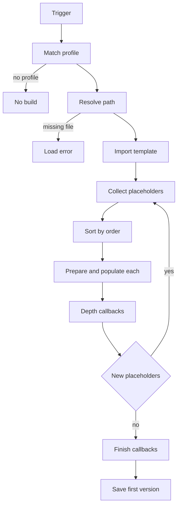

# Templated workfile builder

The templated workfile builder starts a workfile from a prepared **template scene** instead of an empty one, so every artist of a department begins with the same cameras, groups, node graphs and render setup. Placeholders in the template then populate the scene for the task: they load the products it needs, from its own folder or from linked folders such as the assets of a shot, and create the publish instances it is expected to publish. Artists start working instead of loading products and creating instances by hand.

A workfile template is an ordinary scene file of the host application (Maya scene, Houdini hip file, Nuke script, and so on). It only decides what is inside the new workfile; the workfile is named and saved like any other, see [Workfiles naming](naming-conventions.md#workfiles).

A template holds two kinds of content:

- **Fixed scene content**: the department skeleton, for example a default camera, outliner groups and render settings in Maya, or a base node graph with write nodes in Nuke and Houdini. The builder imports it as it is.
- **Placeholders**: marker objects saved in the template. When the template is built, each placeholder acts according to its options: a load placeholder loads matching published products, a create placeholder creates a publish instance, and other types run scripts or apply context settings.

The builder logic is part of the Core addon (`ayon_core.pipeline.workfile.workfile_template_builder`). The template import, the placeholder objects and the placeholder types are implemented by each host addon; hosts without such an implementation have no template builder. At the time of writing these are Maya, Houdini, Nuke, Blender, 3ds Max, After Effects and Silhouette.

## Choosing a template

Each supported host addon has a **Templated Workfile Build** settings group with a list of profiles, set in the studio settings and overridable per project. The profile lists are empty by default, so no template is used until a profile is added. The Core addon has no settings for the builder.

| Host | Setting |
|---|---|
| [Maya](../addons/3d-applications/maya/settings.md#templated-workfile-build-settings) | `ayon+settings://maya/templated_workfile_build` |
| [Houdini](../addons/3d-applications/houdini/settings.md#templated-workfile-build) | `ayon+settings://houdini/templated_workfile_build` |
| [Nuke](../addons/compositing-editorial-applications/nuke/settings.md#templated-workfile-build) | `ayon+settings://nuke/templated_workfile_build` |
| [Blender](../addons/3d-applications/blender/settings.md#templated-workfile-build) | `ayon+settings://blender/templated_workfile_build` |
| [3ds Max](../addons/3d-applications/3dsmax/settings.md#templated-workfile-build) | `ayon+settings://max/templated_workfile_build` |
| [After Effects](../addons/compositing-editorial-applications/after-effects/settings.md#templated-workfile-build-settings) | `ayon+settings://aftereffects/templated_workfile_build` |
| [Silhouette](../addons/compositing-editorial-applications/silhouette/settings.md#templated-workfile-build) | `ayon+settings://silhouette/templated_workfile_build` |

<!-- screenshot: Maya addon settings, Templated Workfile Build with one profile expanded -->

A profile has these fields. The names are those of Maya; the other hosts use the same fields, and their pages list the exact names and defaults.

<Settings prefix="profile">
<Setting name="Task types, Task names">

The context the profile matches, see [Profile matching](#profile-matching). Empty matches all.

</Setting>
<Setting name="Folder types, Folder paths">

Further filters, only in the hosts whose settings offer them, such as Blender.

</Setting>
<Setting name="Path to template" id="template-path">

The template file. The path can be:

- an absolute file path;
- a path with template keys, resolved against the environment variables, the project anatomy roots (`{root[work]}`) and the project (`{project[name]}`, `{project[code]}`);
- a path written for another operating system, which is remapped through the anatomy roots;
- an AYON entity URI starting with `ayon+entity://` or `ayon://`, resolved by the server to a file path, so a published template can be used.

Houdini additionally expands Houdini variables in the path. A path that resolves to no existing file makes the build fail with a template load error.

</Setting>
<Setting name="Keep placeholders">

Keep the placeholders in the scene after the build, so it can be [repopulated](#repopulating). A profile that does not store this option is treated as keeping placeholders.

</Setting>
<Setting name="Apply on launch, Apply to New Scene">

Build the template when the application starts without a workfile, or in every new scene, see [When a build happens](#when-a-build-happens).

</Setting>
<Setting name="Save first workfile version">

Save the built scene as the first version of the workfile when none exists yet.

</Setting>
</Settings>

### Profile matching

The profile for the current context is chosen with the common AYON profile filter. The context values are the task type, task name, folder type and folder path of the current task (the folder filters exist only in the hosts whose settings offer them). For each filter that a profile defines, a matching value scores one point, an empty filter scores nothing, and a non-matching filter excludes the profile. The profile with the highest score wins; with equal scores the profile that is first in the list wins. If no profile matches, no template is applied, and a build started from the menu reports that no matching profile was found.

## The template workfile

The template is created and edited in the host with the host's normal tools: build the scene, add placeholders with the [placeholder manager](#placeholder-manager), and save the file in the shared location the profile points to. **Open Template** in the host menu opens the template file itself, after a confirmation that unsaved changes are lost; this is the way to edit an existing template.

The builder does not interpret the scene content. It imports the whole template into the current scene, in a way that depends on the host (see [Differences between hosts](#differences-between-hosts)), and then processes the placeholders found in it.

<!-- screenshot: a Maya template scene with a camera, outliner groups and two placeholder locators selected in the outliner -->

## Placeholders

A placeholder is a scene object that carries its options as stored data. The object is host specific; the options come from the placeholder plugin. Every placeholder stores the identifier of its plugin and an **Order** value.

### Placeholder types

The Core addon provides the logic of the load and create types, which host addons reuse, plus the plugin base class. Hosts add their own script and context types.

| Type | Purpose | Hosts |
|---|---|---|
| Load | Loads representations of published products that match the placeholder options, using a loader. | Maya, Houdini, Nuke, 3ds Max, After Effects, Silhouette |
| Create | Creates a publish instance with a creator plugin. | Houdini, Nuke, After Effects, Silhouette |
| Run Python Script | Runs Python code at chosen points of the build. | Maya, Houdini, Nuke, Blender, 3ds Max |
| Set Context Settings | Applies the folder and task context settings to the scene. | Maya, Blender, 3ds Max |
| Assign Look | Assigns a look product to the members of the placeholder set. | Maya |

There is no separate publish placeholder type. Publishing is prepared by create placeholders, which produce the publish instances that the Publisher then collects, so the artist does not have to create the expected products by hand.

### Load placeholder options

| Option | Meaning |
|---|---|
| **Folder Builder Type** | Where the products are searched. **Current folder**: the folder of the current task. **Linked folders**: folders linked to the current folder by the chosen link type (incoming links). **All folders**: all folders of the project, narrowed by the folder filter. |
| **Link Type** | Folder-to-folder link type used for linked folders. Lists the project's [link types](../ayon/web-ui/project/anatomy.md#link-types) whose input and output are both folders; a placeholder without a stored link type uses `template`. |
| **Product base type** | Product type of the products to load. The list contains the types supported by the host's loaders. |
| **Representation name** | Name of the representation to load (for example `ma`, `abc`, `usd`). Empty means any representation. |
| **Version** | **Latest** (default) loads the last version of each product. **Hero** loads the hero version; products without a hero version, or without the representation in the hero version, are skipped. |
| **Loader** | The loader plugin that loads the representation. The list contains the loaders available in the host. |
| **Loader Arguments** | A Python dictionary of options passed to the loader, such as `{"camera": "persp"}`. Anything that is not a valid dictionary is ignored and the loader defaults apply. |
| **Order** | Whole number from 0 to 999. Lower values are processed first. |
| **Folder filter** | Optional regular expression matched against folder paths. Applies to the all folders and linked folders types. |
| **Product filter** | Optional regular expression matched against the start of the product name. For example <code>Tire&#124;Box</code> keeps products whose names start with either word. |

For each placeholder the builder collects the representations that match the options and keeps one version per product (the latest, or the hero version). Each kept representation is loaded with the chosen loader. A placeholder with no matching representation does nothing.

A typical use is a shot template whose load placeholder uses **Linked folders**: the folders of the characters and sets linked to the shot are searched, and their published products are loaded into every new shot workfile.

### Create placeholder options

| Option | Meaning |
|---|---|
| **Creator** | The creator plugin that creates the instance. The list contains the manual creators of the host. |
| **Variant** | Variant used to build the [product name](naming-conventions.md#product-naming). |
| **Active** | Whether the created instance is active by default. Default on. |
| **Order** | Whole number from 0 to 999. Lower values are processed first. |

The instance is created for the current folder and task. Pre-create options of the creator are not stored in the placeholder, with one exception: After Effects creates the instance from the placeholder composition by selecting it.

### Run Python Script options

The script placeholder holds up to four scripts: **Run at prepare** (before any placeholder of the current loop is populated), **Run at populate** (when the placeholder itself is populated), **Run after depth iteration** (after each populate loop) and **Run after build** (once after the whole build, even if other placeholders failed). The scripts can access the placeholder object (`placeholder`) and, in callbacks, the build `event`. Its **Order** also orders the callbacks it registers. If the placeholder is not kept, it is deleted after the last script ran.

### Set Context Settings and Assign Look

The **Set Context Settings** placeholder has switches for which scene settings are taken from the current folder and task: frame range, resolution and scene units in all three hosts, plus FPS (Maya) and colorspace (Maya and 3ds Max).

The **Assign Look** placeholder (Maya) is an object set. Its **Product Name** (default `lookMain`) is the look product assigned to the members of the set and to content loaded by other placeholders placed in the set; **Recursive** also covers content loaded by nested placeholders. The assignment runs after each populate loop.

## Build flow

A build has three steps: select the profile, import the template, populate the placeholders.

### When a build happens

| Trigger | Condition |
|---|---|
| Application launch | The profile enables the build on launch, the host started without opening a workfile, and the template path exists. A workfile is opened at launch when one exists and the launch is not set to skip opening the last workfile; the builder does not run then. |
| New scene | The profile enables the build on a new scene, a new scene is created in a running session (not the start-up scene), and the template path exists. |
| Menu | An artist builds from the host's template menu, into the current scene whatever its state; see the tip below. |

After a launch or new-scene build, the builder saves the scene as the first workfile version when the profile enables it and no workfile exists yet for the context.

:::tip Building from the menu
The host's template menu runs the build by hand:

- **Build Workfile from template** (in Maya **Build Workfile (Templates)**) runs the same build as on launch, but into the scene that is open, even a saved workfile, and does not save a first version. It uses the profile of the current context: when no profile matches, nothing is built and an error says that no matching profile was found.
- **Update Workfile from template** (Maya, Houdini, 3ds Max) does not import the template again: it runs the placeholders kept in the scene once more, for example to load products published since the build, see [Repopulating](#repopulating).
- **Create First Workfile from Template** (Blender, 3ds Max) builds the template and saves the first workfile version, like a build on launch.
- **Load as template** in the Maya Loader builds a published `workfile` or `mayaScene` product (`.ma`, `.mb`) as the template, without a profile. Its options keep the placeholders and create the first workfile version.
:::

### Populate loop

Placeholders are collected from the scene, sorted by **Order** (placeholders without an order use 100), and processed one at a time. After all collected placeholders are processed, the scene is scanned again; placeholders that appeared during the process, for example from a template loaded by a load placeholder, are processed in the next loop. The loop ends when a scan finds no new placeholder, or after 1000 loops. Each placeholder is processed once per build. A placeholder that fails is reported in the log and the build continues with the others.

Within one loop:

1. The plugins prepare their placeholders (the **Run at prepare** scripts run here).
2. Each placeholder is populated in order: load placeholders load, create placeholders create instances, script placeholders run their populate script, context placeholders apply settings.
3. The depth callbacks run (**Run after depth iteration**), and cached scene data is cleared.

When no new placeholders remain, the finish callbacks run (**Run after build**), then the builder resets its caches.

Plain-text equivalent:

1. A trigger starts the build: application launch, new scene or a menu action.
2. The builder matches a profile for the task type, task name, folder type and folder path. With no matching profile, no build happens.
3. The builder resolves the template path. If the file does not exist, the build fails with a template load error.
4. The host imports the template into the current scene.
5. The builder collects the placeholders from the scene and sorts them by order, lowest first.
6. Plugins prepare their placeholders, then each placeholder is populated in order.
7. Depth callbacks run and the shared data is cleared.
8. The scene is scanned again. If new placeholders appeared, the flow returns to step 5 for them; otherwise it continues.
9. Finish callbacks run.
10. For launch and new-scene triggers, the first workfile version is saved when the profile enables it and no workfile exists.

### Keeping and deleting placeholders

The keep-placeholders option of the profile is passed to every placeholder as a flag for the build.

- **Off**: a placeholder is deleted after it was populated successfully. A placeholder whose population failed is kept, so the problem can be inspected. A load placeholder that found nothing to load is also deleted.
- **On**: the placeholder stays in the scene. It is hidden (Maya hides it and adds it to the `PLACEHOLDERS_SET` set), and it can be repopulated later.

In Nuke and Silhouette, loaded content takes over the position and connections of the placeholder; Houdini disconnects the placeholder node before destroying it.

### Repopulating

**Update from template** (in the Maya, Houdini and 3ds Max menus) runs the placeholders that already exist in the scene again, without importing the template. Load placeholders in Maya, Nuke, 3ds Max and Silhouette skip representations that are already loaded as containers; load placeholders in Houdini and the create placeholders run their population again. Repopulation only works for placeholders that were kept in the scene.

## Placeholder manager

The placeholder manager is a dialog titled **Workfile Placeholder Manager**, shared by all hosts and opened from the host's template menu or panel. It shows the options of a placeholder plugin as a form, so the fields differ per placeholder type.

| Mode | Opened by | Controls |
|---|---|---|
| Create | The host's create placeholder entry | A combo box lists the placeholder plugins of the host, with the options of the selected plugin below. **Create** makes a new placeholder in the scene; the dialog stays open so several placeholders can be made. **Close** dismisses it. |
| Update | The host's update placeholder entry, with exactly one placeholder selected in the scene | The form is filled with the current values. **Save** writes the options to the placeholder and closes the dialog. |

If the host has no template builder or no placeholder plugins, the dialog shows a message instead of a form. A placeholder is deleted with the host's own deletion of the node or item; the dialog has no delete function.

<!-- screenshot: the Workfile Placeholder Manager in create mode with the Maya load plugin selected and its options form -->

The menu entries (**Build Workfile from template**, **Update Workfile from template**, **Open Template**, **Create Placeholder**, **Update Placeholder** and their host-specific variants) are listed on the addon page of each host, for example [Maya](../addons/3d-applications/maya/index.md), [Houdini](../addons/3d-applications/houdini/index.md) and [Nuke](../addons/compositing-editorial-applications/nuke/index.md).

## Differences between hosts

| Host | Template import | Placeholder object | Notes |
|---|---|---|---|
| Maya | Imported into the current scene with references preserved. Refused when the scene already has a `PLACEHOLDERS_SET` set. Default cameras are made non-renderable and imported instances get the current folder. | A locator, parented under the selected node (script and assign look types use an object set). | Loaded content is parented to the place of the placeholder and added to the sets that contain it. No create placeholder. |
| Houdini | The hip file is merged into the current scene. | A null node in `/out`, or a node type chosen by the loader, with the options in an **AYON Placeholder** parameter folder. | Loaded content takes over the connections of the placeholder; an object merge is created when the placeholder is a SOP node. |
| Nuke | The template nodes are pasted into the current script. | A NoOp node named `PLACEHOLDER`. | Placeholders can be nested in groups; a kept load placeholder tracks sibling nodes so repopulation keeps loaded nodes laid out. |
| Blender | The template file is opened as the current scene, replacing it; instances get the current folder. | A collection. | A launch build is skipped when the profile builds on new scene. No load or create placeholder. |
| 3ds Max | The file is merged into the scene; refused when the template was already imported. | A container, parented under the selected node. | No create placeholder. |
| After Effects | The template is copied over the current project file, which is reopened. | A project item (a composition or a footage placeholder) with its options in the project metadata. | Builds only from the panel; no script placeholder. |
| Silhouette | The template is imported as a project into the current session. | A null node, or a source item for the Source loader. | Builds only from the menu; no script placeholder. |

## Related

- [Naming conventions](naming-conventions.md): path templates, which place the built workfile
- [Workfiles](workfiles.md)
- [Loader](loader.md)
- [Publisher](publisher.md)
- [Scene inventory](scene-inventory.md)
- [Product types](product-types.md)
- [Anatomy: link types](../ayon/web-ui/project/anatomy.md#link-types)
