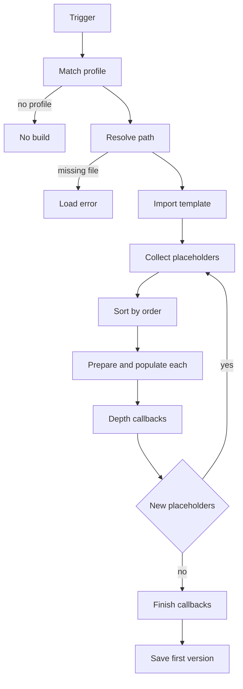

# Templated workfile builder

The templated workfile builder starts a workfile from a prepared template scene instead of an empty one. The template is an ordinary scene file of the host application (Maya scene, Houdini hip file, Nuke script, and so on) that can contain two kinds of content: the fixed scene content itself (cameras, groups, node graphs, render setups) and placeholders. A placeholder is a marker object saved in the template. When the template is built, each placeholder is replaced or acted upon according to its settings: a load placeholder loads matching published products into the scene, a create placeholder creates a publish instance, and other placeholder types run scripts or apply context settings.

The builder is part of the Core addon (`ayon_core.pipeline.workfile.workfile_template_builder`). The placeholder types, the template import and the scene markers are implemented by each host addon. Hosts without a host-side implementation have no template builder.

## Where it is configured

The Core addon has no settings for the template builder. Each host addon that supports it has a settings group, available at studio and project level (and per project and site overrides according to the settings scopes of the server):

| Host addon | Settings group title | Settings key |
|---|---|---|
| Maya | **Templated Workfile Build Settings** | `templated_workfile_build` |
| Houdini, Nuke, Blender, 3ds Max, After Effects, Silhouette | **Templated Workfile Build** | `templated_workfile_build` |

Each group holds a list of **profiles**. A profile selects the template for a context and sets how it is applied.

### Profile fields

| Field | Type | Default | Available in | Meaning |
|---|---|---|---|---|
| **Task types** | list of task types | empty (any) | all hosts | Task types the profile applies to. |
| **Task names** | list of strings | empty (any) | all hosts | Task names the profile applies to. Names are matched as regular expressions. |
| **Folder Types** | list of folder types | empty (any) | Houdini, 3ds Max, Blender | Folder types of the current folder. |
| **Folder paths** | list of strings | empty (any) | Houdini, 3ds Max, Blender | Folder paths of the current folder. |
| **Path to template** | string | empty | all hosts | Location of the template file (see below). |
| **Keep placeholders** | boolean | off | all hosts | Keep the placeholders in the scene after they are populated. |
| **Apply to New Scene** | boolean | off | Maya, Houdini, Nuke, Blender, 3ds Max | Build the template when a new scene is created in a running session. |
| **Apply on `<host>` launch** (Maya, Houdini, Blender, Nuke, 3ds Max) | boolean | on (off in 3ds Max) | Maya, Houdini, Nuke, Blender, 3ds Max | Build the template when the application starts without opening a workfile. |
| **Save first workfile version** | boolean | on | Maya, Houdini, Nuke, Blender, 3ds Max | Save the built scene as the first workfile version when no workfile exists yet. |
| **Create first version** | boolean | on | After Effects, Silhouette | Same purpose as **Save first workfile version**. |

After Effects and Silhouette have no launch or new-scene triggers; the build is started from their menu or panel.

A profile list default is empty, so no template is used until a profile is added.

### Profile matching

The profile for the current context is chosen with the common AYON profile filter. The context values are the task type, task name, folder type and folder path of the current task. For each filter that a profile defines, a matching value scores one point, an empty filter scores nothing, and a non-matching filter excludes the profile. The profile with the highest score wins; when scores are equal the profile that is first in the list wins. If no profile matches, no template is applied and a manual build reports that no matching profile was found.

### Template path

The path can be:

- an absolute file path on the local machine;
- a path with template keys, resolved against the environment variables, the project anatomy roots (`{root[work]}`) and the project (`{project[name]}`, `{project[code]}`);
- a path written for another operating system, which is remapped through the anatomy roots;
- an AYON entity URI starting with `ayon+entity://` or `ayon://`, resolved by the server to a file path.

Houdini additionally expands Houdini variables in the path. A path that resolves to no existing file makes the build fail with a template load error.

## The template workfile

The template is created and edited in the host with the host's normal tools: the artist builds the scene, adds placeholders through the placeholder manager, and saves the file in the shared location the profile points to. The builder does not interpret the scene content; it imports the whole template into the current scene and then processes the placeholders found in it.

The scene content of a template is typically the department skeleton: for example a default camera, outliner groups and render settings in Maya, or a base node graph with write nodes in Nuke and Houdini.

How the template is imported depends on the host:

| Host | Import method |
|---|---|
| Maya | Imports the file into the current scene with references preserved. Refuses to import when the scene already has a `PLACEHOLDERS_SET` set. Makes the default cameras non-renderable and updates the folder path on imported instance sets to the current folder. |
| Houdini | Merges the hip file into the current scene. |
| Nuke | Pastes the template nodes into the current script. |
| Blender | Opens the template file as the current scene (replacing it) and updates the folder path on instances to the current folder. |
| 3ds Max | Merges the file into the scene. Refuses to import when the template was already imported. |
| After Effects | Copies the template over the current project file and reopens it. |
| Silhouette | Imports the template as a project into the current session. |

## Placeholders

A placeholder is a scene object that carries its options as stored data. The object is host specific; the options come from the placeholder plugin. Every placeholder stores the identifier of its plugin and an **Order** value.

### Placeholder types

The Core addon provides the logic for two types that host addons reuse, plus the plugin base class. Hosts add their own script and context types.

| Type | Purpose | Provided by |
|---|---|---|
| Load | Loads representations of published products that match the placeholder options, using a loader. | Core mixin, used by Maya, Houdini, Nuke, 3ds Max, After Effects, Silhouette |
| Create | Creates a publish instance with a creator plugin. | Core mixin, used by Houdini, Nuke, After Effects, Silhouette |
| Run Python Script | Runs Python code at chosen points of the build. | Maya, Houdini, Nuke, Blender, 3ds Max |
| Set Context Settings | Applies the folder and task context settings to the scene. | Maya, Blender, 3ds Max |
| Assign Look | Assigns a look product to the members of the placeholder set. | Maya |

There is no separate publish placeholder type. Publishing is prepared by create placeholders, which produce the publish instances that the Publisher then collects.

### Placeholder plugins by host

| Host | Plugin label (identifier) |
|---|---|
| Maya | **Maya load** (`maya.load`), **Run Python Script** (`maya.runscript`), **Set Context Settings** (`maya.set_context`), **Assign Look** (`maya.assignlook`) |
| Houdini | **Houdini Load** (`ayon.load.placeholder`), **Houdini Create** (`ayon.create.placeholder`), **Run Python Script** (`houdini.runscript`) |
| Nuke | **Nuke load** (`nuke.load`), **Nuke create** (`nuke.create`), **Run Python Script** (`nuke.runscript`) |
| Blender | **Run Python Script** (`blender.runscript`), **Set Context Settings** (`blender.set_context`) |
| 3ds Max | **Max load** (`max.load`), **Run Python Script** (`max.runscript`), **Set Context Settings** (`max.set_context`) |
| After Effects | **AfterEffects load** (`aftereffects.load`), **AfterEffects create** (`aftereffects.create`) |
| Silhouette | **Silhouette load** (`silhouette.placeholder.load`), **Silhouette create** (`silhouette.placeholder.create`) |

### Load placeholder options

| Option | Meaning |
|---|---|
| **Folder Builder Type** | Where the products are searched. **Current folder** (`context_folder`): the folder of the current task. **Linked folders** (`linked_folders`): folders linked to the current folder by the chosen link type (incoming links). **All folders** (`all_folders`): all folders of the project, narrowed by the folder filter. |
| **Link Type** | Folder-to-folder link type used when the builder type is linked folders. Lists the project's link types whose input and output are both folders. |
| **Product base type** | Product type (product base type) of the products to load. The list contains the types supported by the host's loaders. Stored data of older placeholders that use `product_type` or `family` is still read. |
| **Representation name** | Name of the representation to load (for example `ma`, `abc`, `usd`). Empty means any representation. |
| **Version** | **Latest** (default) loads the last standard version of each product. **Hero** loads the hero version; products without a hero version, or without the representation in the hero version, are skipped. |
| **Loader** | The loader plugin that loads the representation. The list contains the loaders available in the host. |
| **Loader Arguments** | A Python dictionary of options passed to the loader, such as `{"camera": "persp"}`. Anything that is not a valid dictionary is ignored and the loader defaults apply. |
| **Order** | Whole number from 0 to 999. Lower values are processed first. |
| **Folder filter** | Optional regular expression matched against folder paths. Applies to the all folders and linked folders types. |
| **Product filter** | Optional regular expression matched against the start of the product name. For example `Tire|Box` keeps products whose names start with either word. |

For each placeholder the builder collects the representations that match the options and keeps one version per product (the latest, or the hero version). Representations that are already loaded are skipped when placeholders are repopulated (see below). Every kept representation is loaded with the chosen loader. A placeholder with no matching representation does nothing.

### Create placeholder options

| Option | Meaning |
|---|---|
| **Creator** | The creator plugin that creates the instance. The list contains the manual creators of the host (hidden creators are excluded). |
| **Variant** | Variant name used to compile the product name through the creator's product name template. |
| **Active** | Whether the created instance is active by default. Default on. |
| **Order** | Whole number from 0 to 999. Lower values are processed first. |

The instance is created for the current folder and task. Pre-create options of the creator are not stored in the placeholder, with one exception: After Effects creates the instance from the placeholder composition by selecting it.

### Run Python Script options

| Option | Meaning |
|---|---|
| **Order** | Order of the placeholder, 0 to 999. Also orders the callbacks it registers. |
| **Run at prepare** | Script run before any placeholder of the current loop is populated. |
| **Run at populate** | Script run when the placeholder is populated. Default script prints the placeholder. |
| **Run after depth iteration** | Script run after each populate loop. |
| **Run after build** | Script run once after the whole build, even if other placeholders failed. |
| **Nodetype** (Maya) | Placeholder node type created: locator or object set (default). Applies only on creation. |

The scripts can access the placeholder object (`placeholder`) and, in callbacks, the build `event`. If the placeholder is not kept, it is deleted after the last script ran.

### Set Context Settings options

Boolean options select which scene settings are set from the current folder and task. Maya and 3ds Max expose **Set FPS** (Maya only), **Set Resolution**, **Set Frame Range**, **Set Colorspace** (Maya and 3ds Max) and **Set Scene Units**. Blender exposes **Set Resolution**, **Set Frame Range** and **Set Scene Units** (default off).

### Assign Look options

The Assign Look placeholder (Maya) is an object set. **Product Name** (default `lookMain`) is the look product assigned to the members of the set and to content loaded by other placeholders that were placed in the set. **Recursive** also assigns the look to content loaded by nested placeholders. The assignment runs after each populate loop.

### The placeholder object by host

| Host | Object that represents the placeholder |
|---|---|
| Maya | A locator, parented under the selected node if one is selected (script and assign look types use an object set). |
| Houdini | A null node in `/out` (or a node type chosen by the loader) with the options stored as parameters in an **AYON Placeholder** folder. |
| Nuke | A NoOp node named `PLACEHOLDER`. |
| Blender | A collection (options stored on the parent object when one is selected). |
| 3ds Max | A container, parented under the selected node if one is selected. |
| After Effects | A project item (a composition or a footage placeholder) with its options stored in the project metadata. |
| Silhouette | A null node, or a source item for the Source loader. |

## Build flow

A build has three steps: select the profile, import the template, populate the placeholders.

### When a build happens

| Trigger | Condition |
|---|---|
| Application launch | The profile has **Apply on `<host>` launch** on, the host started without opening a workfile, and the template path exists. A workfile is opened at launch when it exists and the launch is not set to skip opening the last workfile; the builder does not run then. |
| New scene | The profile has **Apply to New Scene** on, a new scene is created in a running session (not the start-up scene), and the template path exists. |
| Menu | An artist builds explicitly from the host's template menu. The template is imported into the current scene regardless of its state. |

After a launch or new-scene build, the builder saves the scene as the first workfile version when **Save first workfile version** (or **Create first version**) is on and no workfile exists yet for the context. Blender and 3ds Max also have a menu entry that creates the first workfile from the template.

### Populate loop

Placeholders are collected from the scene, sorted by **Order** (placeholders without an order use 100), and processed one at a time. After all collected placeholders are processed, the scene is scanned again; placeholders that appeared during the process, for example from a template loaded by a load placeholder, are processed in the next loop. The loop ends when a scan finds no new placeholder, or after 1000 loops. Each placeholder is processed once per build. A placeholder that fails is reported in the log and the build continues with the others.

Within one loop:

1. The plugins prepare their placeholders (the **Run at prepare** scripts run here).
2. Each placeholder is populated in order: load placeholders load, create placeholders create instances, script placeholders run their populate script, context placeholders apply settings.
3. The depth callbacks run (**Run after depth iteration**), and cached scene data is cleared.

When no new placeholders remain, the finish callbacks run (**Run after build**), then the builder resets its caches.

Plain-text equivalent:

1. A trigger starts the build: application launch, new scene or a menu action.
2. The builder matches a profile for the task type, task name, folder type and folder path. With no matching profile, no build happens.
3. The builder resolves the template path. If the file does not exist, the build fails with a template load error.
4. The host imports the template into the current scene.
5. The builder collects the placeholders from the scene and sorts them by order, lowest first.
6. Plugins prepare their placeholders, then each placeholder is populated in order.
7. Depth callbacks run and the shared data is cleared.
8. The scene is scanned again. If new placeholders appeared, the flow returns to step 5 for them; otherwise it continues.
9. Finish callbacks run.
10. For launch and new-scene triggers, the first workfile version is saved when the profile enables it and no workfile exists.

### Keeping and deleting placeholders

The profile option **Keep placeholders** is passed to every placeholder as a flag for the build.

- Off: a placeholder is deleted after it was populated successfully. A placeholder whose population failed is kept, so the problem can be inspected. A load placeholder that found nothing to load is also deleted.
- On: the placeholder stays in the scene. It is hidden (Maya hides it and adds it to the `PLACEHOLDERS_SET` set), and it can be repopulated later.

A profile that does not store the option is treated as keeping placeholders.

Deleting is host specific: Maya removes the node from its sets before deleting it, Houdini disconnects the node before destroying it, and the other hosts remove the node or item. In Nuke and Silhouette, loaded content takes over the position and connections of the placeholder.

### Repopulating

Update from template (exposed in the Maya, Houdini and 3ds Max menus; the other hosts have no menu entry for it) runs the placeholders that already exist in the scene again, without importing the template. Load placeholders in Maya, Nuke, 3ds Max and Silhouette skip representations that are already loaded as containers. Load placeholders in Houdini and the create placeholders run their population again. Repopulation only works for placeholders that were kept in the scene.

## Placeholder manager

The placeholder manager is a dialog titled **Workfile Placeholder Manager** that is shared by all hosts. It edits the options of a plugin as a form built from the plugin's attribute definitions, so the fields differ per placeholder type.

| Mode | Opened by | Controls |
|---|---|---|
| Create | The host's create placeholder menu entry | A combo box lists the placeholder plugins of the host. The form below shows the options of the selected plugin. **Create** makes a new placeholder in the scene. **Close** dismisses the dialog (the dialog stays open after creating, so several placeholders can be made). |
| Update | The host's update placeholder menu entry, with exactly one placeholder selected in the scene | The plugin combo box is hidden and the form is filled with the current values. **Save** writes the options to the placeholder and closes the dialog. **Close** dismisses it. |

If the host has no template builder or no placeholder plugins, the dialog shows a message instead of a form. A failure while creating or saving shows a **Something went wrong** message. Selecting none or several placeholders for the update action is reported as an error by the host.

Deleting a placeholder is done with the host's own deletion of the node or item; the dialog has no delete function. The template build deletes placeholders itself when **Keep placeholders** is off.

## Menu entries by host

All hosts place the entries in a Template Builder group of the AYON menu, except where noted.

| Host | Entries |
|---|---|
| Maya | Menu **Build Workfile (Templates)**: **Build from Template**, **Update from Template**, **Open Template**, **Create Placeholder**, **Update Placeholder**. |
| Houdini | **Template Builder**: **Build Workfile from template**, **Update Workfile from template**, **Open Template**, **Create Placeholder...**, **Update Placeholder**. |
| Nuke | **Template Builder**: **Build Workfile from template**; **Open template**, **Create Place Holder**, **Update Place Holder** (the last three are hidden in Nuke Assist). |
| Blender | **Templated Workfile**: **Create First Workfile from Template**, **Build Workfile from Template**, **Open Template**, **Create Placeholder**, **Update Placeholder**. |
| 3ds Max | **Template Builder**: **Create First Workfile from Template**, **Build Workfile from Template**, **Update Workfile from Template**, **Open Template**, **Create Placeholders**, **Update Placeholders**. |
| After Effects | Panel buttons **Create placeholder**, **Update placeholder**, **Build Workfile from template**. |
| Silhouette | **Template Builder**: **Build Workfile from template**, **Open template**, **Create Place Holder**, **Update Place Holder**. |

**Open Template** opens the template file itself as the current scene after a confirmation that unsaved changes are lost (**Opening template**). This is the way to edit a template.

## Differences between hosts

| Topic | Differences |
|---|---|
| Profile filters | Folder types and folder paths are available in Houdini, 3ds Max and Blender settings. |
| Triggers | Maya, Houdini, Nuke, Blender and 3ds Max can build on launch and on new scene. In Blender, a launch build is skipped when the profile builds on new scene. After Effects and Silhouette build only from their menu. |
| Create placeholders | Not available in Maya, Blender and 3ds Max. |
| Script placeholders | Not available in After Effects and Silhouette. |
| Houdini | Placeholder nodes live in `/out`; a loader can define its own placeholder node type; loaded content takes over the connections of the placeholder, and an object merge is created when the placeholder is a SOP node. |
| Maya | Loaded content is parented to the place of the placeholder locator and added to the sets that contain the placeholder. Importing a second template into a scene that already has a build is refused. |
| Nuke | Placeholders can be nested in groups; a kept load placeholder tracks sibling nodes so repopulation keeps loaded nodes laid out. |
| After Effects | The template file replaces the current project file; placeholders are project items with data in the project metadata. |

## Related

- [Workfiles](workfiles.md)
- [Loader](loader.md)
- [Publisher](publisher.md)
- [Scene inventory](scene-inventory.md)
- [Product types](product-types.md)
- [Core addon settings](../addons/essentials/core/settings.md)
