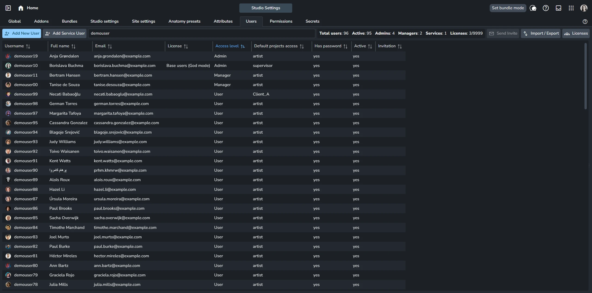
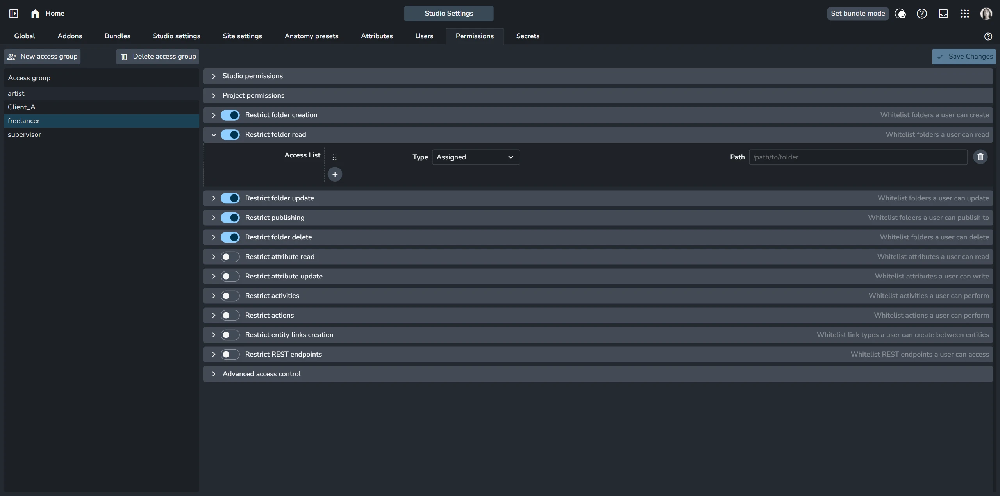
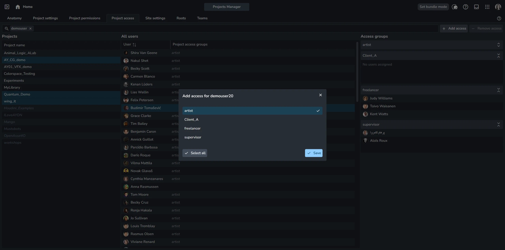
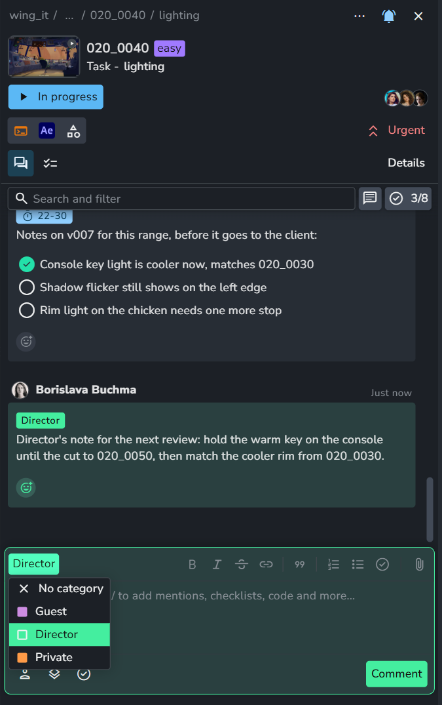
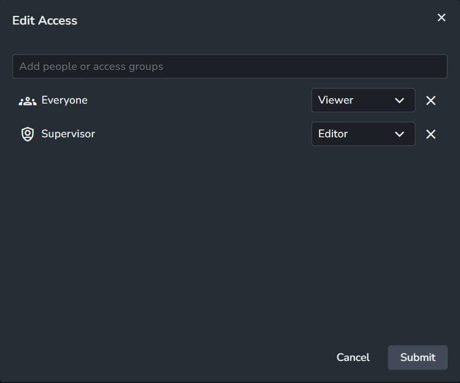
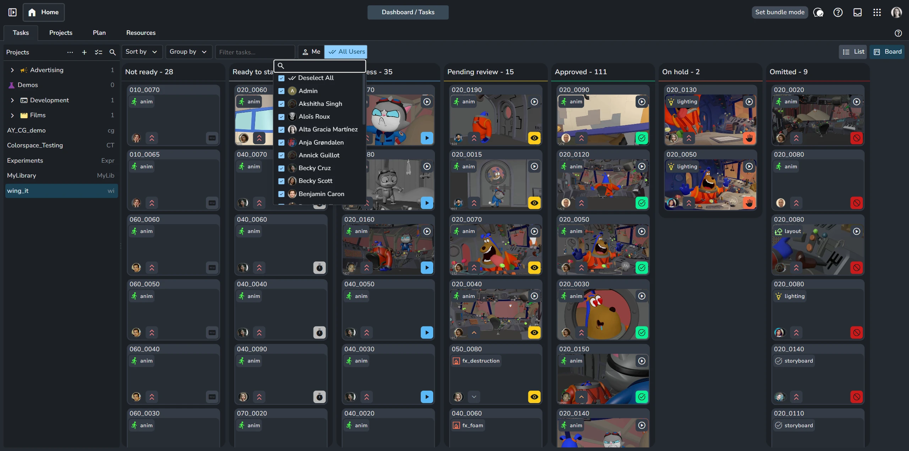

# Control who sees what

A production has people with different needs: producers who see everything, artists who need their own tasks, freelancers who must not see the rest of the project, and clients who only watch the shots sent to them. AYON controls this in two layers: the access level of each account, and access groups that apply inside each project. The rules are explained in [Permissions](../ayon/how-ayon-works/permissions.md); this page explains what they are useful for in a production. Permissions cover AYON data and actions only, not the files on the studio storage.

## Decide who runs the production

Every account has an access level, set on the [Users](../ayon/web-ui/studio/users.md) page:

- **Admin:** runs the server, with addons, bundles and server settings.
- **Manager:** runs the production. Managers work in every project, create projects, change the studio and project settings and manage users and access groups, but not admin accounts or the server itself.
- **User:** sees only the projects where an access group is assigned, and works within it.

Producers and coordinators who set up projects and staff them are usually managers. The differences between managers and admins are listed in [Managers and admins](../ayon/how-ayon-works/permissions.md#managers-and-admins). Scripts and services sign in with service accounts.

## Limit what artists can see and change

An [access group](../ayon/web-ui/studio/permissions.md) is a set of rules for users with the **User** level. Its restrictions decide, per project, which folders a user can read, create in, change, publish to or delete in, which attributes they can read or change, whether they can comment or upload reviewables, and which actions and link types they can use. A new server has three groups:

- **supervisor:** no restrictions.
- **artist:** cannot create or delete folders, so the project hierarchy stays as production set it up.
- **freelancer:** reads and publishes only in folders with a task assigned to the user, and cannot create, change or delete folders.

Typical uses are freelancers or outsourced vendors who see only their own shots, artists who can change the status of their tasks but not their dates, or a budget attribute hidden from everyone but the producers. When a user has several groups in one project, each group can only add rights; see [How several groups combine](../ayon/how-ayon-works/permissions.md#how-several-groups-combine).

A project with stricter rules, for example to meet the security requirements of a client, can override a group for that project only, on its [Project permissions](../ayon/web-ui/project/project-permissions.md) page.

## Give people access, project by project

A user sees a project only once an access group is assigned to them in it, on the [Project access](../ayon/web-ui/project/project-access.md) tab. The same user can be a supervisor on one show and an artist on another. Several projects can be selected at once, for example to give a new artist access to every running show in one step, and removing the last group takes the project away from the user.

The **Default projects access** of a user, set on the Users page, gives them groups in every project created afterwards, so permanent staff do not have to be added to each new project. A coordinator who is not a manager can still staff projects, with an access group that allows changing **Project access**; see [Typical setups](../ayon/how-ayon-works/permissions.md#typical-setups).

## Bring in external reviewers

Clients and other external people do not need an account: with the [Review addon](../addons/production-tracking/review/index.md), they join a review session as guests and see only that session, never the rest of the project. What guests can do is described in [Bring clients into review](client-review.md).

## Keep some conversations and items private

<Columns widths="45 55">
<Column>

With the [Power Pack](../addons/production-tracking/power-pack/index.md), access can be set on single items as well:

- **Comment categories** limit who sees a comment, for example internal notes that clients in a review session must not read. See [Comment categories](../ayon/web-ui/details-panel.md#comment-categories).
- **Lists** get their own access, so a list of shots for one vendor or one delivery can be shown only to the people who need it. See [List access](../ayon/web-ui/production-tracking/lists.md#list-access).
- **Views** are shared with chosen users, access groups or teams, with a level for each. See [Views](../ayon/web-ui/views.md#access-levels).

</Column>
<Column>

</Column>
</Columns>

## Control access in the Planner

<Columns widths="45 55">
<Column>

The plan of a studio holds information not everyone should see or change, such as who is booked on an unannounced project or what a person costs. In the [Planner](../addons/production-tracking/planner/index.md), **event access** decides who sees the details of bookings and who can edit them, for the studio and per project, and each custom attribute of bookings and resources, such as a day rate, has its own access. Editing task dates on the Schedule follows the access groups of the project instead. See [Access and permissions](../addons/production-tracking/planner/index.md#access-and-permissions).

</Column>
<Column>

</Column>
</Columns>

## What managers see that artists do not

Managers and admins are never limited by access groups, so their pages show the whole project. For users with the **User** level, the pages follow their access groups:

- The [Overview](../ayon/web-ui/production-tracking/overview.md) and [Task progress](../ayon/web-ui/production-tracking/task-progress.md) list only the folders and tasks the user may read, and cells the user may not change are read-only in the Overview.
- [Home tasks](../ayon/web-ui/home/tasks.md) shows the tasks of other users to admins and managers, and to other users only when none of the selected projects has read restrictions in their access group.
- [Reports](../addons/production-tracking/reports/index.md) count only the entities of folders the user can access.
- In the Planner, users who are not managers see the resource of another person only when they share a project with that person.

## Related

- [Permissions](../ayon/how-ayon-works/permissions.md)
- [Users](../ayon/web-ui/studio/users.md)
- [Permissions (studio settings)](../ayon/web-ui/studio/permissions.md)
- [Project access](../ayon/web-ui/project/project-access.md)
- [Project permissions](../ayon/web-ui/project/project-permissions.md)
- [Review addon](../addons/production-tracking/review/index.md#guest-access)
- [Planner addon](../addons/production-tracking/planner/index.md#access-and-permissions)
