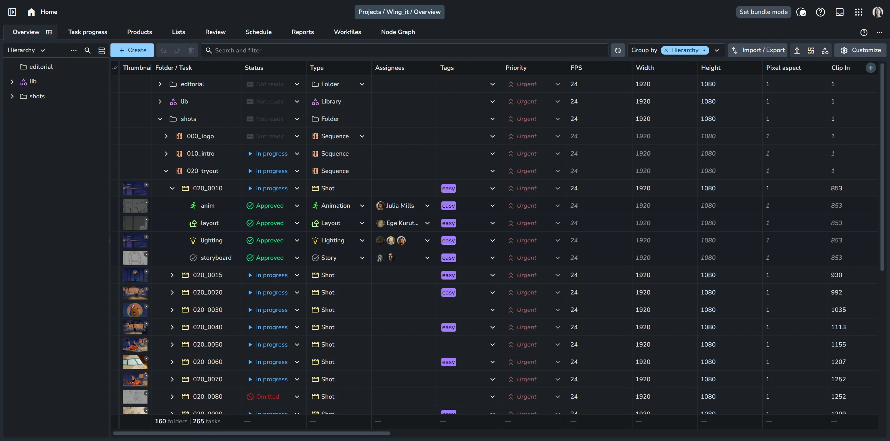
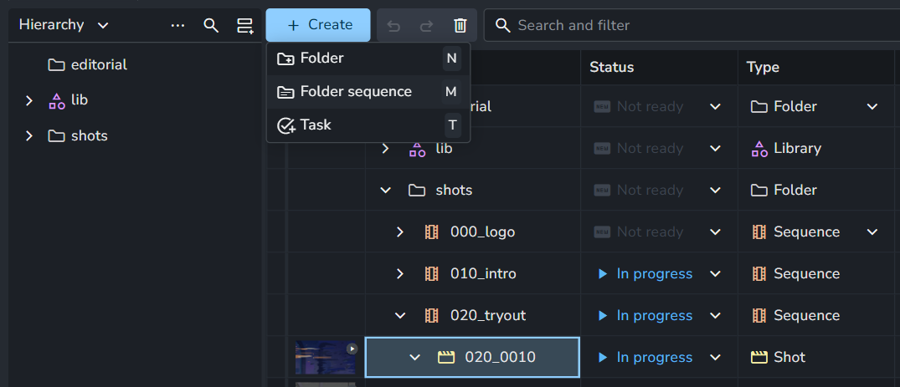
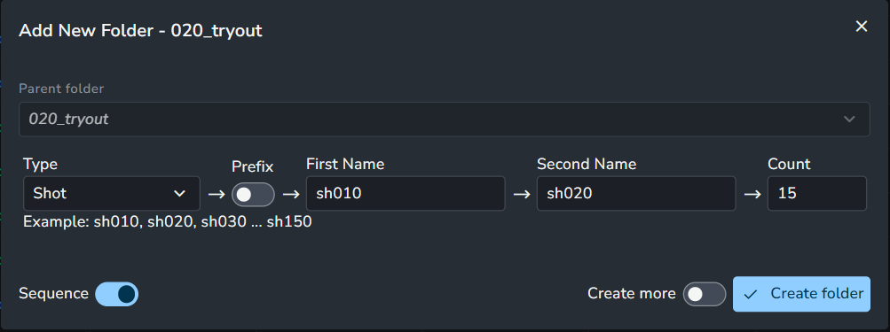
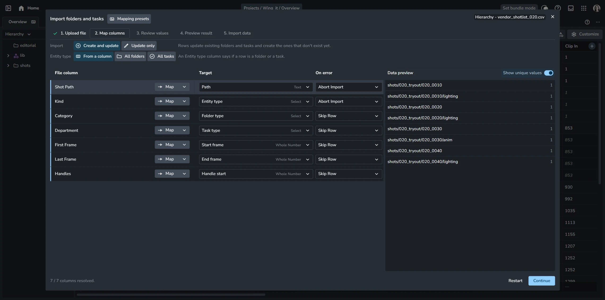
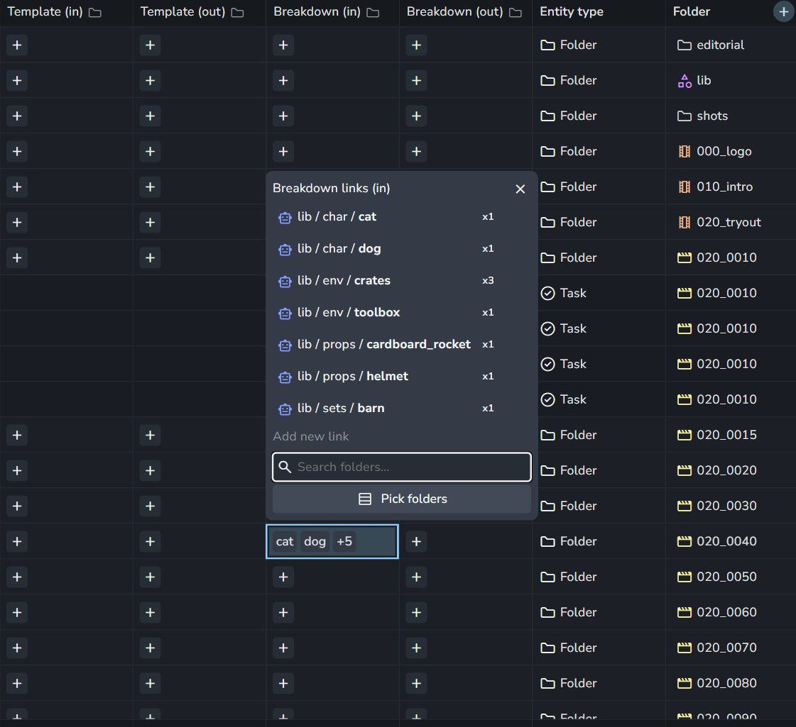

# Break down the work

Before work can be assigned or tracked, it has to exist in the project: one folder for each episode, sequence, shot and asset, and one task for each piece of work on it. This breakdown is what every later page counts. Task progress shows its shots and task types, the Planner schedules its tasks, and reports are built from it. AYON offers several ways to build it, by hand, from a spreadsheet or from the edit, and they can be mixed in one project. The ways and the dialogs they use are described in [Creating a project](../ayon/how-ayon-works/creating-a-project.md#ways-to-build-it).

## Shape the hierarchy

<Columns widths="45 55">
<Column>

The folders of a project form a tree. A typical film project has an `assets` folder with characters, props and environments, and sequences that hold the shots; an episodic project adds an episode level above the sequences. The levels are a production choice: the folder types that exist come from the project anatomy (see [Set up a production](setting-up-a-production.md)), and any folder can hold folders and tasks.

</Column>
<Column>

</Column>
</Columns>

The hierarchy is built in the [Project overview](../ayon/web-ui/production-tracking/overview.md), the spreadsheet of the project's folders and tasks. Folders and tasks are created there, renamed, moved, and edited in cells like a spreadsheet, so the breakdown can be filled in and corrected in one place. Values such as the frame rate or resolution are inherited from the parent folder, and a shot can override the values when needed to differ from its sequence.

## Create shots in numbered runs

<Columns widths="45 55">
<Column>

Shots are usually numbered in steps, such as `sh010`, `sh020`, `sh030`, so that a shot added later fits between two existing ones. A **Folder sequence** in the Overview creates such a run in one step: from a first name, a second name that sets the step, and a count, it creates every folder of the run, optionally with the name of the parent folder in front. Tasks are then added to many shots at once by selecting the shots.

</Column>
<Column>

</Column>
</Columns>

With the [Power Pack](../addons/production-tracking/power-pack/index.md), [hierarchy templates](../addons/production-tracking/power-pack/index.md#hierarchy-templates) store templates with a set of folders and tasks, such as a sequence with its shots or an asset with all its tasks, and apply it for every new sequence or asset once created.

## Import a shot list

A breakdown often exists before the project does, as a shot list in a spreadsheet, a bid or an export of another tracker. [Import CSV](../ayon/web-ui/dialogs/import-csv.md) creates the folders and tasks from it, with their types, statuses, tags and attributes such as frame ranges. The columns of the file do not have to match AYON names: each column and each value is mapped in the dialog, and the result is previewed before anything is written.

The import also updates what already exists. Rows that match an existing folder or task update it instead of creating a second one, so the same spreadsheet can be imported again after the client sends a new revision, or a vendor's tracker can update the statuses of the shots it works on. With the Power Pack, the column mappings can be saved as presets for imports that repeat.

## Link the assets used in each shot

<Columns widths="45 55">
<Column>

A shot list says which shots exist; an asset breakdown says what is in each of them. In AYON this is stored as `breakdown` links from each asset to the shots or environments that use it, edited in the [links manager](../ayon/web-ui/links-manager.md) from the link columns of the Overview. A count on each link records how many times an asset is used, such as three copies of the same crate. Links can be copied from one shot and pasted on others that use the same set.

</Column>
<Column>

</Column>
</Columns>

The breakdown answers production questions directly in the table: which shots a character appears in, which assets must be finished before a sequence can start, which shots are affected when an asset changes. Links are stored on the server, so the pipeline can use them too: a [workfile template](../pipeline/template-builder.md) of a shot can load the latest published versions of the assets linked to it.

Creating folders and tasks creates no links: breakdown links are added by hand, or by a tool or script through the API. The pipeline creates links of its own when it publishes, between versions: from the versions loaded into a workfile to the published workfile, and from the workfile to the versions made from it. See [Links created by publishing](../ayon/how-ayon-works/entities.md#links-created-by-publishing).

## Let the edit create the shots

<!-- screenshot: Hiero timeline of wing_it with clips tagged for publishing, next to the resulting shots in the Overview -->

When the cut exists, the pipeline can create the shots from it instead of from a list: editorial publishing in Hiero, Resolve or Flame, or from an edit file in the Tray Publisher, creates a shot for each clip with its hierarchy and frame range, and publishes its plates into it. A new revision of the cut updates the existing shots. See [What the pipeline brings to production tracking](pipeline.md#build-the-project-from-the-edit).

## Related

- [Creating a project](../ayon/how-ayon-works/creating-a-project.md#project-hierarchy)
- [Project overview](../ayon/web-ui/production-tracking/overview.md)
- [Import CSV](../ayon/web-ui/dialogs/import-csv.md)
- [Links manager](../ayon/web-ui/links-manager.md)
- [Production workflow](../ayon/how-ayon-works/production-workflow.md#2-build-the-folder-hierarchy-and-tasks)
- [Put the right people on it](assigning-people.md)
