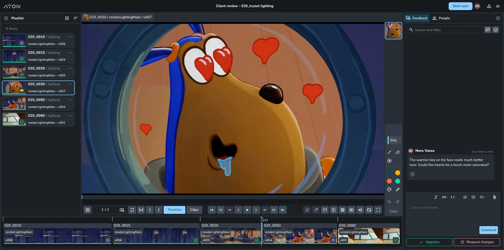
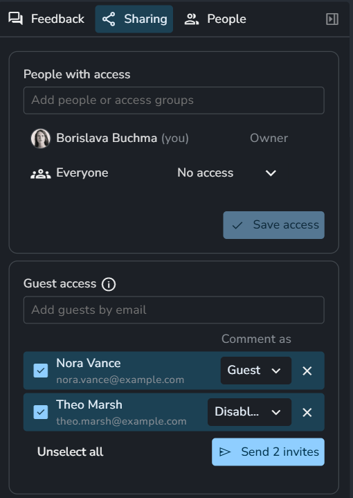
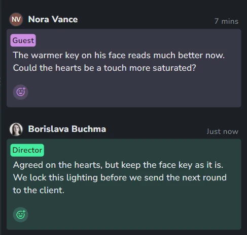
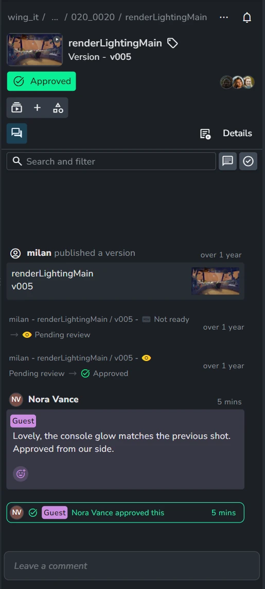
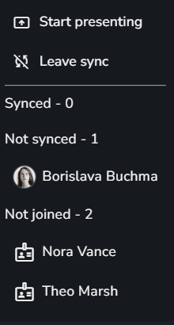

# Bring clients into review

Clients, directors and vendors need to see the work and give notes, but should not see the rest of the project, the internal statuses or the team's own discussion. AYON lets them join a review session as **guests**. A guest sees one session and nothing else, and the guest's notes and decisions arrive in the same activity feed as the team's, so nobody copies client feedback from emails into the tracker. Guest access is part of the [Review addon](../addons/production-tracking/review/index.md), a paid addon on AYON Pro and included in AYON Studio (see [AYON plans](../ayon/plans.md)).

## Share a session, not the project

A guest has no access to the project beyond the sessions shared with them. A guest does not see the Home pages, the project pages, the inbox or the internal version statuses, and opens the session with compact controls: no comparison, no sharing and no editing of the session. The session list, statuses and comments of the team stay internal.

Only saved sessions can be shared; temporary sessions are never visible to guests. A producer typically prepares a list of the shots to show, turns it into a saved session for the client, and keeps a separate session for the internal review of the same shots.

## Invite named reviewers

<Columns widths="45 55">
<Column>

For a client supervisor or a director who reviews regularly, a guest is added by email in the **Share** tab of the session. **Invite** sends an email with a sign-in link, so the guest needs no password. The link works once and for 24 hours; when it has expired, opening it sends a new one. Invitations need [email to be set up](../ayon/deployment/on-premise.md#email) on a self-hosted AYON server.

</Column>
<Column>

</Column>
</Columns>

Adding and removing guests needs manage access to the session. Removing a guest from a session ends their access to it, and keeps them in the guest list of the project. See [Invited guests](../addons/production-tracking/review/index.md#invited-guests).

## Open a link for a wider audience

When a session has to reach people whose email addresses are not known, for example everyone at the client's office, an open link gives anyone who has it access to that one session without signing in. Each visitor is asked for a name before entering the session. A session can have several links, for example one per client team, and removing a link ends the access of everyone using it at once. See [Open links](../addons/production-tracking/review/index.md#open-links).

## Decide what clients can write and read

<Columns widths="60 40">
<Column>

Guests comment only when they are given a comment category, per guest or per open link; without one they can watch but not comment. Comment categories are a feature of the [Power Pack](../addons/production-tracking/power-pack/index.md#comment-categories). The category does two things:

- **What the team sees:** every guest comment carries the category, so client notes stand out in the feed in the category color, and the category's access rule decides which users see them.
- **What the guest sees:** a guest sees the comments made in the session in categories they may access, and comments without a category. Notes in a category guests cannot access, such as an internal **Director** or **Private** category, stay hidden from them.

</Column>
<Column>

</Column>
</Columns>

That lets the team discuss a shot in the same feed during a client session without the client reading the internal notes. The categories and their access rules are set in the [Power Pack settings](../addons/production-tracking/power-pack/settings.md#comment-categories).

## Collect the client's decision

<Columns widths="60 40">
<Column>

Guests have **Approve** and **Request changes** buttons. Their decision is posted to the activity feed of the version as **approved this** or **requested changes**, together with the comment being written, and the clip card in the session shows the result. The team finds client decisions in the feed, with the **Review session** filter of the [activity feed](../ayon/web-ui/details-panel.md#feed-filter), and in the inbox of the people who watch the version, with the **Reviews** filter.

A guest's decision does not change the version status. The producer or supervisor reads it and sets the status, so the client's approval and the studio's approval stay two separate steps; see [Review and approve](review-and-approve.md#approve-or-send-back).

</Column>
<Column>

</Column>
</Columns>

## Review live with the client

<Columns widths="45 55">
<Column>

For a call with the client, the session can be synchronized: one person presents, and everyone who joins the sync, guests included, sees the same frame, comparison and annotations. The **People** tab shows who is synced, who is not, and which invited guests have not opened the session yet. See [Synchronized sessions](../addons/production-tracking/review/index.md#synchronized-sessions).

</Column>
<Column>

</Column>
</Columns>

## Related

- [Review addon](../addons/production-tracking/review/index.md#guest-access)
- [Review and approve](review-and-approve.md)
- [Keep the conversation in one place](conversations.md)
- [Comment categories](../ayon/web-ui/details-panel.md#comment-categories)
- [Permissions](../ayon/how-ayon-works/permissions.md#layer-1-access-level)
