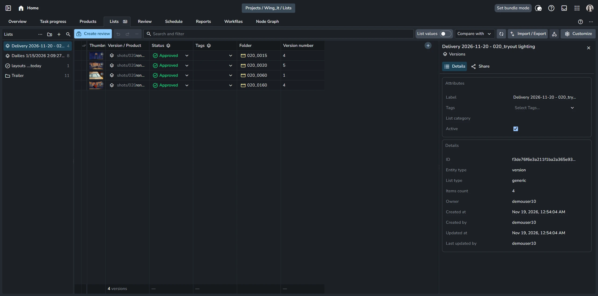
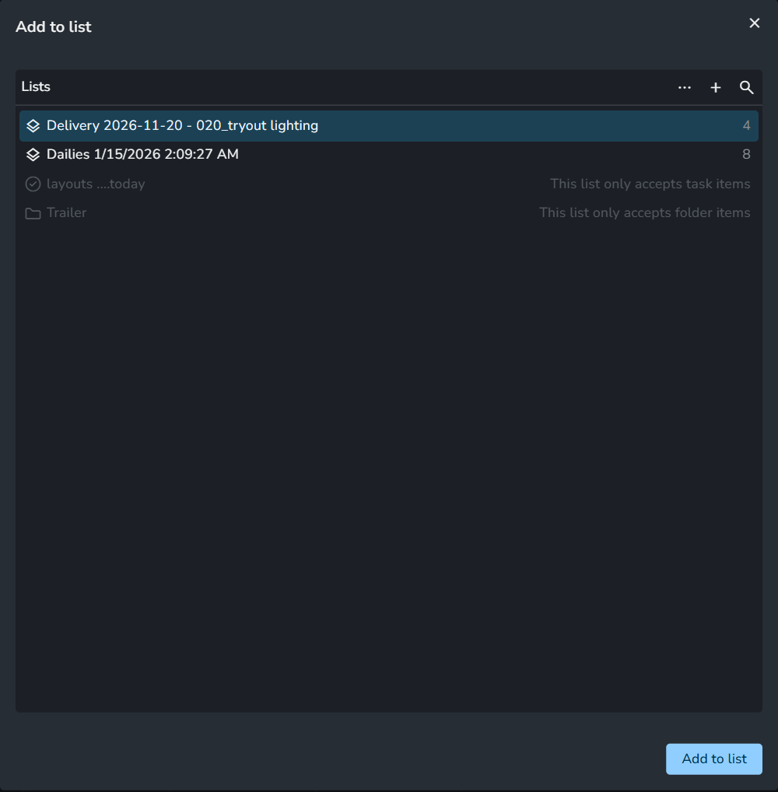

# Prepare deliveries

A delivery hands approved work to a client or a vendor. AYON helps with three parts of it: knowing what goes out, finding the right version of each shot, and copying the published files into a delivery folder with the names the client expects. The tools are simple. They copy files to a location on studio storage; sending the package to the client, and tracking what was received, happen outside AYON. The [Production workflow](../ayon/how-ayon-works/production-workflow.md#9-deliver) shows where delivery fits in the whole production.

## Collect what goes out

<Columns widths="45 55">
<Column>

A [list](../ayon/web-ui/production-tracking/lists.md) of versions is the natural place to collect a delivery: one list per delivery or per client session, filled with **Add to list** from the Products page, the Overview or the details panel. The list keeps the exact versions that were chosen, in their order, outside the folder hierarchy, so it also records what was sent once the delivery is done. The same list can be turned into a review session for a last check with the client; see [Bring clients into review](client-review.md).

</Column>
<Column>

</Column>
</Columns>

With the [Power Pack](../addons/production-tracking/power-pack/index.md), a list can have its own [attributes](../ayon/web-ui/production-tracking/lists.md#list-attributes-and-list-values), such as a delivery date, the vendor or an approval checkbox per item, and [access settings](../ayon/web-ui/production-tracking/lists.md#list-access) that limit who can change it.

## Pick the approved versions

Only approved work should leave the studio. On the [Products](../ayon/web-ui/production-tracking/products.md) page, the search filter **Product Version: Latest Done** shows, for each product, its highest version whose status has the done state, even when newer versions are still in work. That is not the same as combining **Latest** with an **Approved** status filter, which only lists the products whose very latest version is approved, and only for that one status, while a project can have several statuses with the done state. It is also different from **Latest per folder** in Customize, which keeps a single latest version per folder. In the [web viewer](../ayon/web-ui/web-viewer.md#version-toolbar), the **Approved** button jumps to the latest approved version of a product, to check it before it goes into the list. How versions get approved is described in [Review and approve](review-and-approve.md).

## Copy the files to the delivery location

<!-- screenshot: the Deliver N versions dialog opened for a wing_it delivery list, with a delivery template and the representations selected -->

The **Deliver Versions** action of the [pipeline](pipeline.md) copies the published files of the selected versions to a delivery folder and renames them by a delivery template of the project anatomy, for example into a folder per delivery date with the client's file naming. It runs on the workstation, in the AYON launcher, and can be started in two ways:

- from the desktop [Browser](../pipeline/loader.md#delivery), opened from the tray, on selected versions;
- from the web app, with the **Deliver versions (launcher action)** web action on selected versions or on a list of versions. Started from a list, it delivers every version of the list and fills the list label into the template, so each delivery can land in a folder named after its list.

The dialog chooses the delivery template, which representations to copy (for example only the EXR renders and the review movie), and can renumber frame sequences. It ends with a report of what was copied and what failed. Delivery templates are empty in a new project; an admin adds them to the anatomy first, see [Naming conventions: Delivery](../pipeline/naming-conventions.md#delivery).

The action copies files that were published through the pipeline. Versions uploaded in the web app hold only reviewables on the AYON server and cannot be delivered this way; their media can be downloaded one file at a time from the **Version files** tab of the [details panel](../ayon/web-ui/details-panel.md#tabs).

## Re-process for the client's specification

When the client needs another format, resolution or color space than the published files, the [Batch delivery addon](../addons/pipeline-features/batch-delivery/index.md) sends the selected versions to a Deadline render farm, where Nuke re-processes them by a delivery preset and publishes the result back to the project. It needs a Deadline farm and Nuke; see [AYON plans](../ayon/plans.md) for the plans that include it.

## Send a delivery sheet

With the Power Pack, a list or the Overview can be [exported](../ayon/web-ui/production-tracking/overview.md#export) to Excel or CSV, for example as a sheet of the delivered shots and versions with their list attributes to send with the files.

## Related

- [Lists](../ayon/web-ui/production-tracking/lists.md)
- [Products](../ayon/web-ui/production-tracking/products.md)
- [Loader: Delivery](../pipeline/loader.md#delivery)
- [Core addon](../addons/essentials/core/index.md)
- [Batch delivery addon](../addons/pipeline-features/batch-delivery/index.md)
- [Production workflow](../ayon/how-ayon-works/production-workflow.md#9-deliver)
