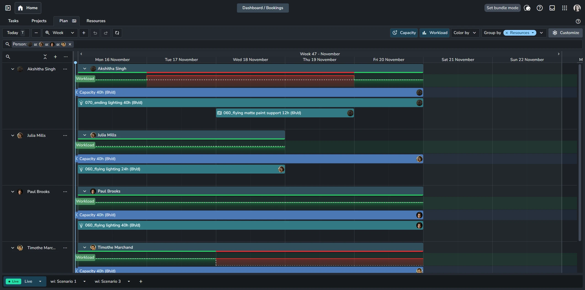
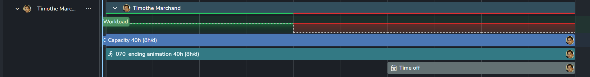
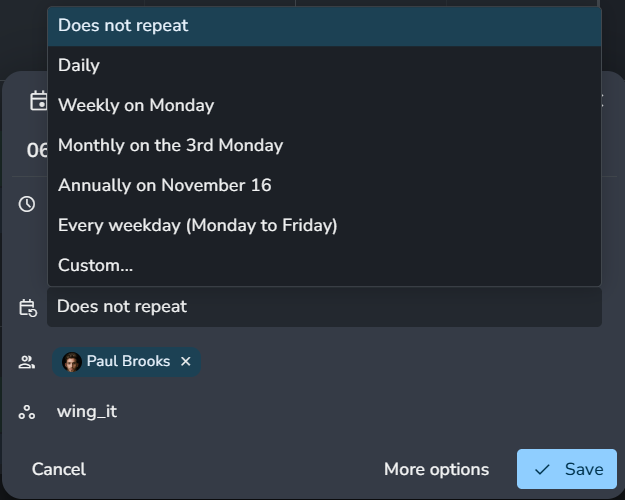
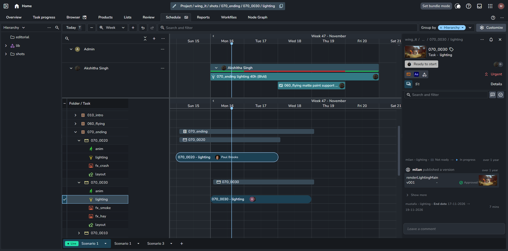
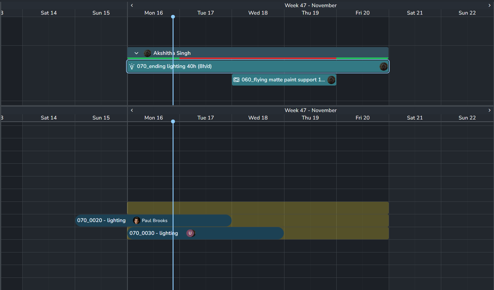

# Planning

The [Planner addon](../addons/production-tracking/planner/index.md) plans a studio at three levels, each one against the level above it:

- **Capacity:** the people of the studio, and the time each of them can work.
- **Projects:** who is booked on which project, sequence or department, and for how long.
- **Tasks:** the dates of each shot or asset task of a project, planned within the time the studio has booked for it.

**Scenarios** keep other versions of the plan next to the real one. The addon page describes every feature of the **Plan**, **Resources** and **Schedule** pages; this page explains what they are useful for in a production.

## Plan capacity

Capacity is the time a person can work, for example 8 hours a day from Monday to Friday. With capacity set, the plan shows for every person how much of that time is already booked, on every project. That makes it possible to answer "can we start this project next month?" or "can we take this extra shot?" from the plan, before promising a date, instead of asking each lead.

People are not the only resources: rooms, workstations and software licences can be planned the same way, and a placeholder such as "Senior compositor" can be planned before the person is hired.

### Time off

<Columns widths="45 55">
<Column>

Holidays, sick days and other absences are entered as time off in the same plan. Time off removes the person's capacity for those days, so work booked over it shows as a conflict right away, when the holiday is entered, not when the deadline comes.

</Column>
<Column>

</Column>
</Columns>

### Studio routines

<Columns widths="45 55">
<Column>

Dailies, production meetings, supervisor rounds or fixed studio hours take time every week. Entered once as recurring events, for example every weekday or every first Monday of the month, they stay in everyone's plan and are counted in the workload, so the plan shows the time people really have for work. A single occurrence can be moved or removed without changing the rest of the series.

</Column>
<Column>

</Column>
</Columns>

## Plan projects

A booking puts a person on a piece of work for a period: a project, a sequence, a department task. Bookings of all projects sit in the same plan, so a person booked on two projects at once is visible as soon as it happens. The workload line above each person turns from green to orange and red when the bookings exceed the capacity, as for the artist booked on lighting and on matte paint support in the screenshot at the top. A coordinator can then move or shorten one booking, or find someone else, before the week starts.

Bookings have a status, such as tentative or confirmed, so a plan can hold work that is likely, such as a bid that is not won yet, marked as tentative until it is agreed. The statuses can be renamed to match the studio's own booking stages. A project can be booked before it is set up for production: the booking dialog can create it in AYON as a basic project (name, code and default anatomy), to be configured later.

## Plan the tasks of a project

Once people are booked on a project, the tasks of the project get their own start and end dates and assignees. 

The project's **Schedule** shows those tasks as bars on a timeline, so the dates and the people on each shot are visible at a glance instead of being looked up row by row in the Overview, and tasks can be moved or stretched there. 

**Show Plan**, toggled with `P` (after clicking in the timeline) or from the right-click menu of the timeline, shows the studio plan above the tasks, so a producer schedules each shot within the time and capacity already agreed in the studio plan. A booking's dates can also be applied in one step to the tasks it covers, for example to every lighting task of a sequence.

Selecting a booking in the plan highlights it on the rows of the tasks it covers, matched by task type or by the people booked. That shows at a glance whether each task fits in the booked time, or where booked time is left unused, as for the lighting booking below, which runs to Friday while the lighting task of the shot ends on Tuesday.

Smaller projects often need no schedule: the start and end dates of tasks can be set directly in the [Overview](../ayon/web-ui/production-tracking/overview.md), and they show on Home tasks and in reports.

## Prepare scenarios

A scenario is a separate version of the plan. Only one scenario is live; changes in the others stay in them. Scenarios serve two purposes:

- **Exploring:** compare ways of doing the work before deciding, for example staffing a project with two more artists for a shorter time, or moving a sequence to another team.
- **Preparing:** keep a plan ready for a situation that may happen, for example a client moving a delivery date or a second season being confirmed. When it happens, the prepared scenario is made live.

In the Schedule, only the live scenario changes the real task dates, so a scenario can be worked on without affecting what artists see.

## Related

- [Planner addon](../addons/production-tracking/planner/index.md)
- [Subtasks](subtasks.md)
- [Production workflow](../ayon/how-ayon-works/production-workflow.md#4-plan)
- [Project overview](../ayon/web-ui/production-tracking/overview.md)
- [Home](../ayon/web-ui/home/index.md)
