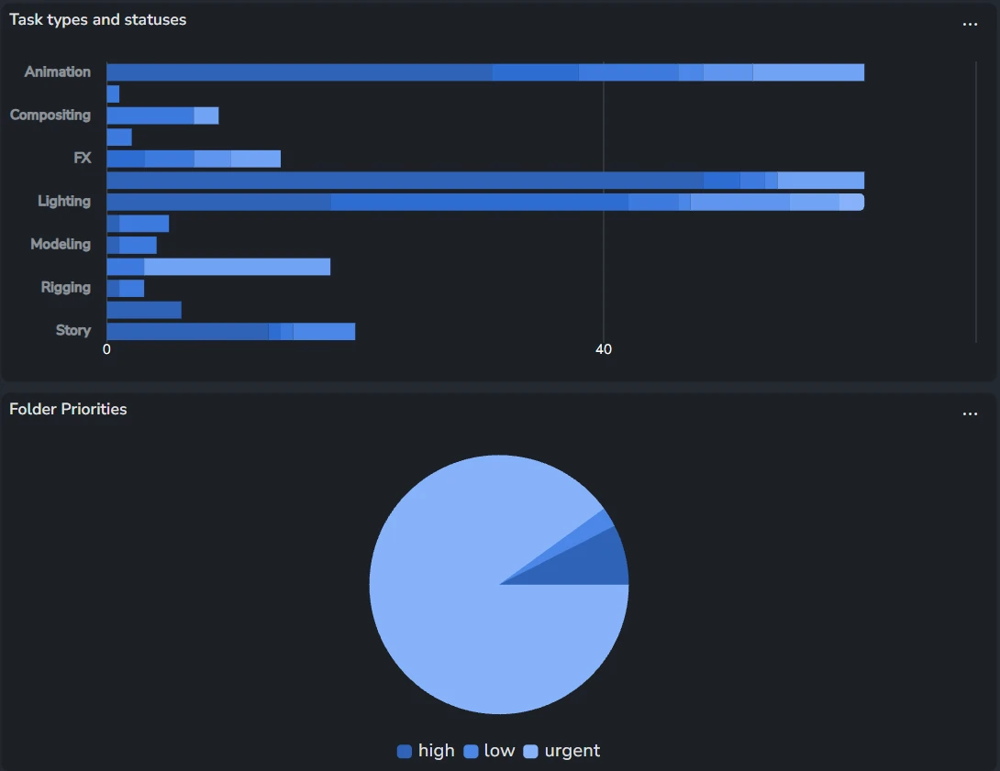
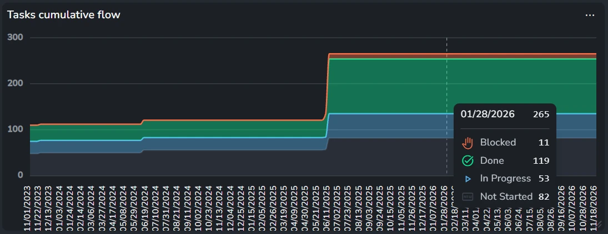
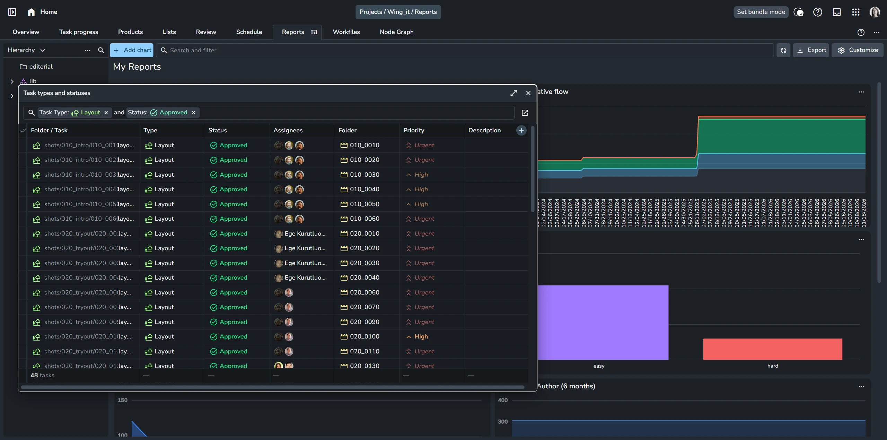
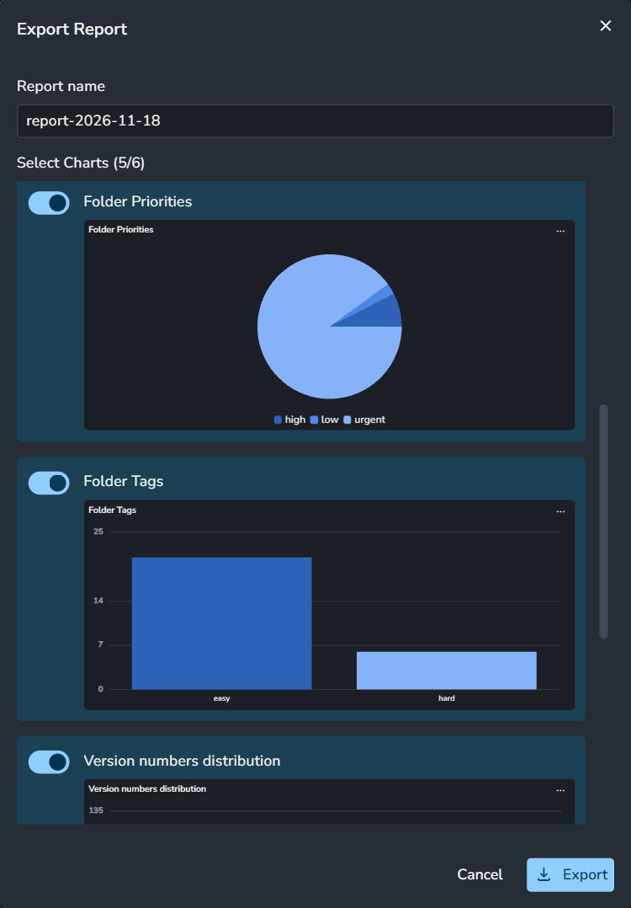
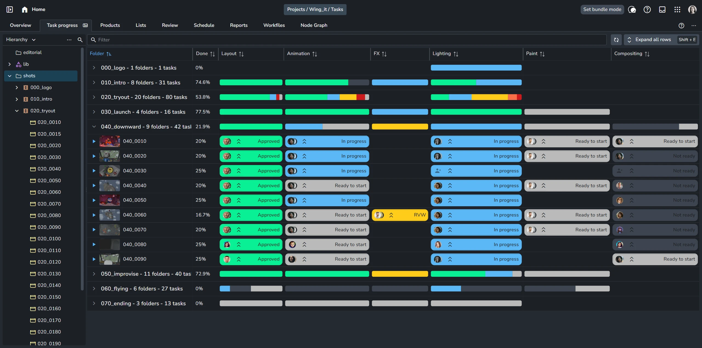
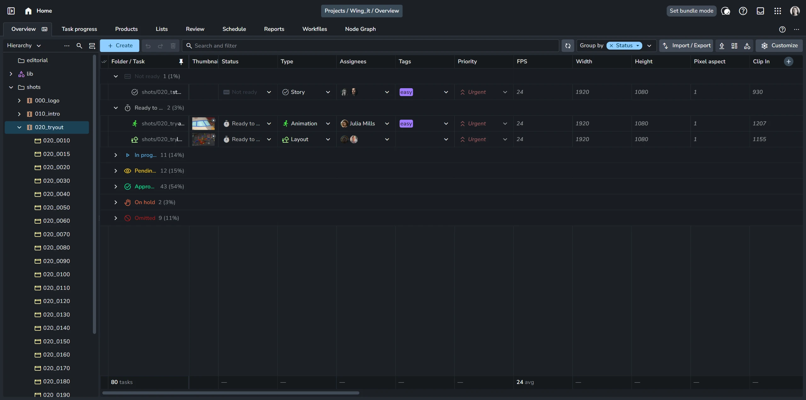
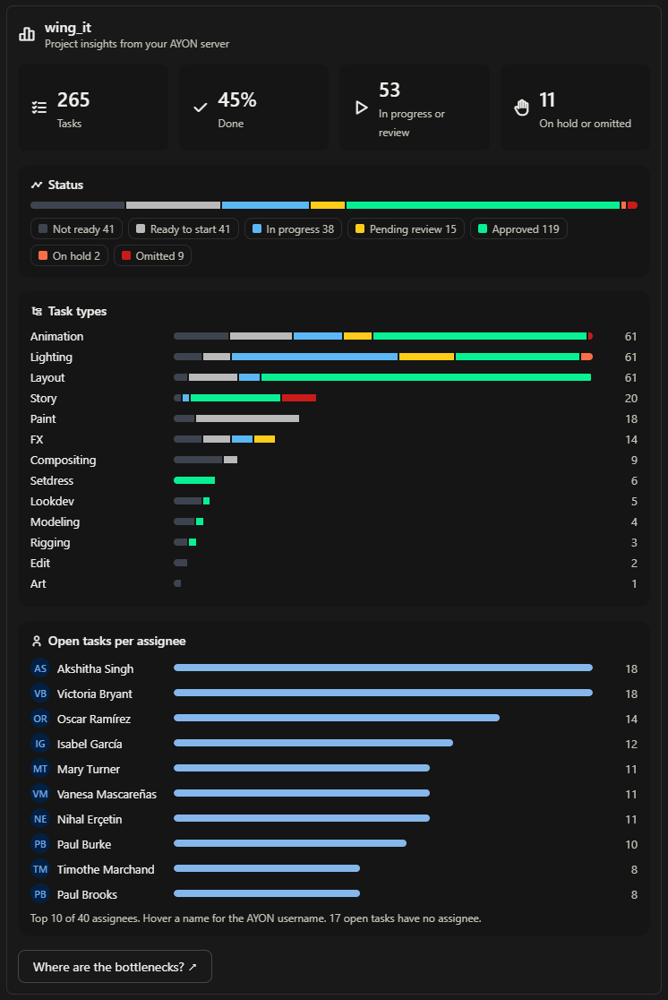

# Report on the production

Reporting answers the questions asked above the daily work: how much is done, how fast the work moves, where it is stuck, and what to tell the client or the studio. AYON keeps the data for this in the project: the status, assignees and attributes of every folder and task, and every version published. The [Reports addon](../addons/production-tracking/reports/index.md) turns that data into charts; the project pages give progress and totals without it. Following the state of each task day to day is described in [See where every task stands](tracking-progress.md); this page is about summarizing it.

## See the project at a glance

The **Reports** tab of a project is a dashboard of chart cards and text cards. Each chart counts the tasks, folders or versions of the project, or sums, averages or takes the minimum or maximum of a numeric attribute, grouped by a field such as task type, status, state, assignee, tags or any attribute, and optionally split by a second field, for example task types split by status. A project starts with six charts, such as the tasks of each type by status, folders by priority and versions by author, and more can be added from templates or built from scratch. Text cards hold Markdown: a title, context for the charts around them, or the conclusions of a review.

The charts answer the usual review questions without a spreadsheet: how many tasks each department still has open, how many shots are high priority, how many frames a sequence has, who publishes the most versions. For tasks, two calculated metrics measure the pace of the work: **cycle time**, the days from the start of work to done, and **days overdue**, the days past the end date. Templates show the average cycle time per task type and the days overdue per assignee.

The Reports addon is a licensed addon: without a license for it, the Reports page shows a license screen. Each dashboard covers one project; the addon has no cross-project report.

## Follow how the work moves over time

Timeline charts show how counts change over days, weeks or months. The **Tasks cumulative flow** chart shows the tasks of the project by state over time, so a growing band of tasks in progress, or a flat line of finished ones, shows the pace of the production before a deadline is missed. Versions over time by author show the output of the team.

The addon records the state of the project every day. Before a project's first charts, an administrator starts **Initialize history** on its Reports tab, once per project: it rebuilds the earlier history from the events of the project, so timelines also cover the time before the addon was installed. Until then, other users see that Reports is not set up for the project. Other timelines count by a date field, such as the end dates of tasks per week, which shows how much work is due in each coming week.

## Find the work behind a number

A click on a bar, slice or point of a chart opens a window with the tasks or folders it counts, in the same table as the Overview, with its columns, sorting and grouping. Filter chips at the top show what the rows are limited to: the clicked point, the filter of the chart and the filter of the dashboard. From there the tasks open in the [Overview](../ayon/web-ui/production-tracking/overview.md), in a view of choice, to be reassigned, rescheduled or commented on. The window shows the first 10,000 entities; it is not available for version charts, calculated metrics and timelines.

The other way also works: the column menu of the Overview charts the values of a column, for a quick look without building a dashboard.

## Report on one part of the project

The slicer on the left limits the whole dashboard to a part of the project: a sequence or other folders, assignees, statuses or task types. The filter bar adds filters on any field of folders, tasks and versions, and a single chart can have its own filter. The same dashboard then reports on one sequence for its supervisor, one department for its lead, or the work of one artist.

The charts and their layout are saved as a [view](../ayon/web-ui/views.md). With the Power Pack, views can be saved and shared, so a project can keep several dashboards, for example one for the weekly production meeting and one for the client.

## Share a report

<Columns widths="45 55">
<Column>

**Export** saves the chosen charts as a PDF, with the studio logo, the report name and the date, ready to send to a client or to studio management. The CSV export gives the numbers behind the charts for further work in a spreadsheet. A single chart can also be copied as a table or as an image, for example into a presentation, and a text card on the dashboard carries the conclusions with the charts.

</Column>
<Column>

</Column>
</Columns>

The counts follow the access of the user: users who are not managers or admins count only the entities of the folders they can access, and users who see only their own tasks do not see the other tasks of a folder in charts either. See [Control who sees what](access.md).

## Progress per sequence and department

[Task progress](../ayon/web-ui/production-tracking/task-progress.md) gives progress figures without the Reports addon. Each folder has a **Done** percentage, the share of its active tasks whose status has the done state. A parent row, such as a sequence, shows the same percentage for all its shots, and one bar per task type with the share of each status in its color. Collapsed to the sequences, the page reads as a progress report per sequence and per department.

## Totals and exports from the Overview

With the [Power Pack](../addons/production-tracking/power-pack/index.md), the [Project overview](../ayon/web-ui/production-tracking/overview.md) has a summary footer. It counts the folders, tasks and selected rows, and shows a calculation for each column: the sum, average, minimum or maximum of a number, or how many cells are filled. Combined with the slicer and filters, it gives figures such as the total frame count of a sequence or the number of shots without an assignee.

With the Power Pack, the Overview also exports to Excel or CSV: the whole table or the selected rows, with the values as shown or as stored. The export contains every row the user may read, which makes it the way to hand a shot list or a status report to people outside AYON.

## Numbers that the project does not hold yet

<!-- screenshot: the Overview of wing_it with a calculated progress attribute shown as a column on the sequence rows -->

Some figures a producer reports on are not stored anywhere, such as the share of finished tasks in each sequence or the frame length with handles. With the Power Pack, [calculated attributes](../addons/production-tracking/power-pack/calculated-attributes.md) compute such values with formulas from the other attributes of an entity and, for folders, from the tasks and folders below it. The value is stored as the attribute's value, so it can be shown as a column, filtered, grouped, summed in the Overview footer and used as a grouping field in Reports charts.

## Ask an AI assistant connected to AYON

<Columns widths="45 55">
<Column>

The [AYON MCP server addon](../addons/production-tracking/mcp/index.md), an experimental addon, lets an AI assistant such as Claude read the project with the permissions of the person asking: its folders, tasks, versions and events. A producer can ask in plain language, such as "how is wing_it doing?" or "which shots are waiting for review?", and get the answer from the project data.

The assistant gathers the data with the addon's tools and presents it in its own way, as text, a table or a chart it draws itself. The example on the right was made by Claude from twelve calls to the addon: the task count and done share, the tasks per status and task type, and the open tasks of each artist. Another assistant, or another question, gives another layout.

</Column>
<Column>

</Column>
</Columns>

:::note In development
Insight cards served by AYON itself, the same in every chat app that supports them, and cards that propose a change and wait for a person to approve it, are being developed as a proof of concept. They are not released yet.
:::

## Related

- [Reports addon](../addons/production-tracking/reports/index.md)
- [See where every task stands](tracking-progress.md)
- [Task progress](../ayon/web-ui/production-tracking/task-progress.md)
- [Project overview](../ayon/web-ui/production-tracking/overview.md#power-features)
- [Calculated attributes](../addons/production-tracking/power-pack/calculated-attributes.md)
- [Views](../ayon/web-ui/views.md)
