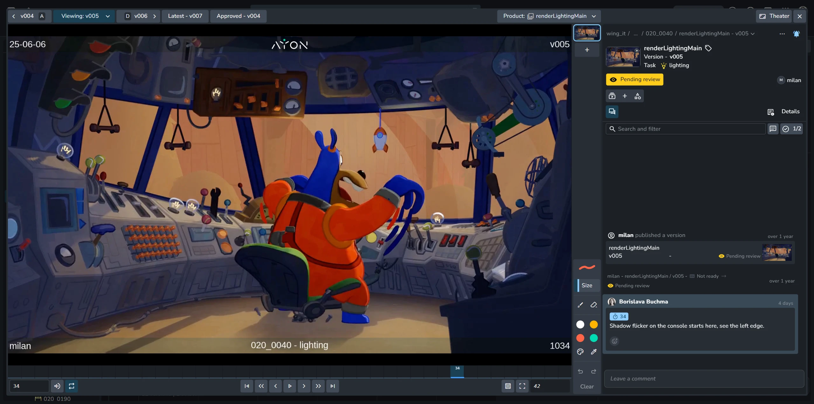
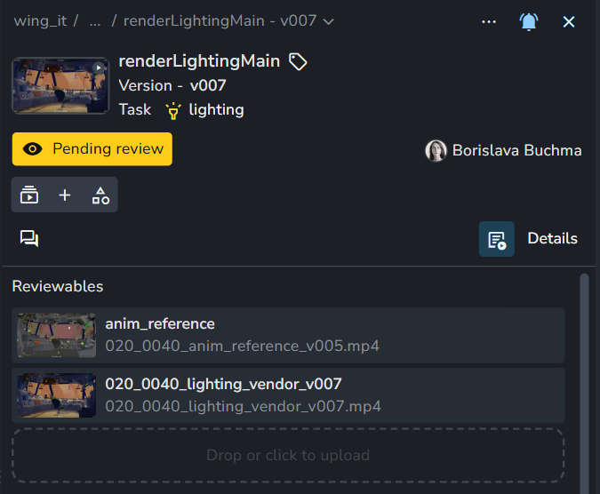
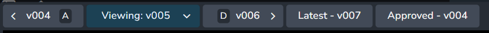
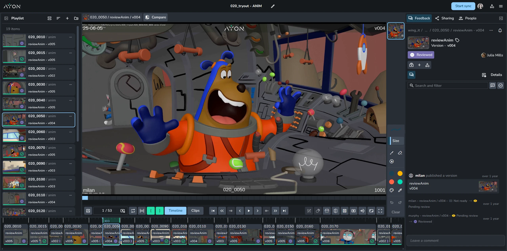
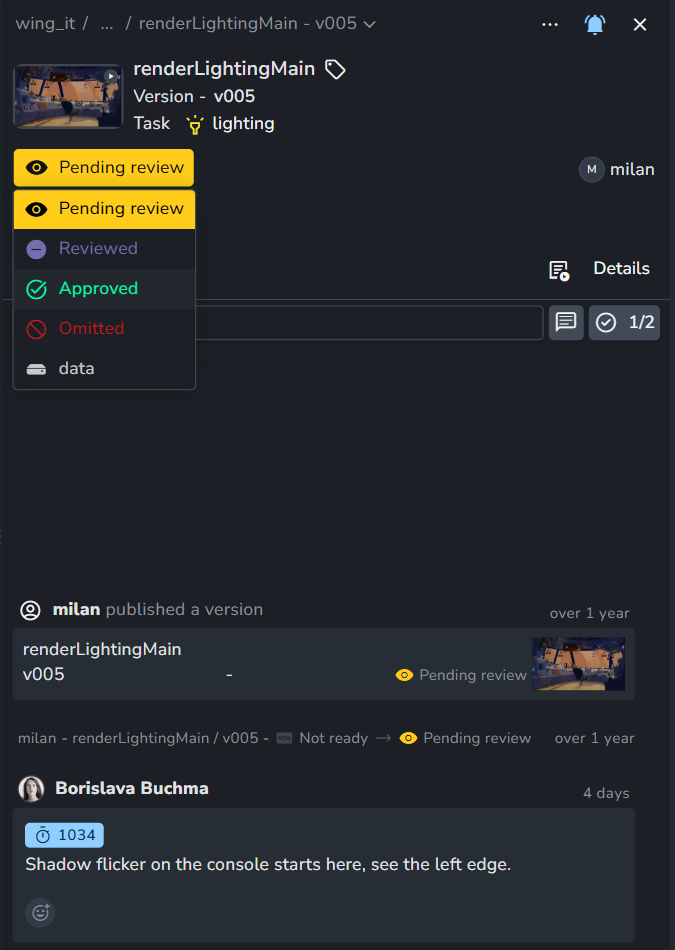

# Review and approve

Review is where a production decides whether work is done. In AYON every version can carry media to watch, the notes are written next to it, and the decision is recorded as a status, so the next person sees what was asked and what was approved without searching emails or meeting notes. Supervisors can review one submission at a time in the web app, run dailies in a review session, or watch at full quality in a desktop player. The [Production workflow](../ayon/how-ayon-works/production-workflow.md#7-review) shows where review fits in the whole production.

## Something to watch on every version

<Columns widths="45 55">
<Column>

A version holds its media as [reviewables](../ayon/web-ui/details-panel.md#version-files-tab): videos or images that play in the browser. A version can have several, for example a beauty render and a close-up of a detail, so a reviewer sees everything the artist wants to show in one place.

</Column>
<Column>

</Column>
</Columns>

Reviewables come from two sources:

- **The pipeline:** with the [pipeline](pipeline.md), publishing makes the review media. A movie is encoded from the rendered or exported files, optionally with burnins, and uploaded to the version as a reviewable, so artists do not export and upload previews by hand. See [Review media](../pipeline/color-management-in-publishing.md#review-media). Pipeline uploads the reviewable and it's processed and saved on the sever and it's separate from the file in the pipeline.
- **An upload:** without the pipeline, an artist drops a movie or images on the task in the web app, which creates a version with that media. See [Versions without a pipeline](track-work-without-a-pipeline.md).

## Check one submission

The [web viewer](../ayon/web-ui/web-viewer.md) opens over the page the reviewer is on, with `Spacebar` or from a thumbnail, on the Overview, Task progress, Products, Lists or Home tasks. It plays the reviewables of a version next to its activity feed, so watching and commenting happen in one place, without leaving the list of work to review.

Switching to another version of the product keeps the current frame, so the new version can be compared with the previous one, or with the last approved one, at the same moment of the shot. A comment can be linked to a frame or a frame range, and clicking it later jumps back to that frame, so the artist sees exactly what the note is about. With the [Power Pack](../addons/production-tracking/power-pack/index.md), reviewers can also draw on the frame; the drawing is attached to the comment.

## Review together

Dailies, team reviews and client reviews need a playlist that several people watch together. Review sessions provide it. They come from the [Review addon](../addons/production-tracking/review/index.md), a paid addon on AYON Pro and included in AYON Studio (see [AYON plans](../ayon/plans.md)).

A session is a playlist of versions, created from a selection of folders, tasks or versions, or from a [list](../ayon/web-ui/production-tracking/lists.md) such as the shots for tomorrow's dailies. Typical uses:

- **Dailies:** a coordinator collects the day's versions in a list and turns it into a session. One presenter controls playback and everyone in a synchronized session sees the same frame.
- **Supervisor rounds:** a supervisor opens a temporary session from a selection of tasks to go through the latest work, without saving anything.
- **Comparing:** a version can be compared with another version in the player, for example the current lighting against the previous one.

Comments and annotations made in a session are written to the activity feed of each version, so the notes stay with the work after the session ends. Saved sessions stay in the project, so a review can be reopened later. External reviewers can join as guests; see [Bring clients into review](client-review.md).

## Review from the desktop

<!-- screenshot: OpenRV with a wing_it version list loaded and the AYON activity panel docked next to the player -->

Some reviews need the full quality of the published files and the color tools of a desktop player. The [Review Desktop addon](../addons/production-tracking/review-desktop/index.md), a beta that needs the Review addon, opens a list of versions or a review session in OpenRV on the reviewer's workstation, with the published files instead of the web media. An AYON activity panel inside the player shows the feedback of each version, and the reviewer can comment, draw annotations and change the version status there. The notes reach the same activity feed as notes from the web app, so artists find all of them in one place.

## Approve or send back

<Columns widths="45 55">
<Column>

The outcome of a review is a status: the version is set to **Approved**, or back to a status that asks for more work, and the task status is set to match. Notes and statuses reach the artist in the [inbox](../ayon/web-ui/inbox/index.md), the next version arrives, and the loop repeats until the work is approved. Because statuses count by state, approved work shows up right away in the progress figures; see [See where every task stands](tracking-progress.md).

</Column>
<Column>

</Column>
</Columns>

With the Power Pack, [status sync](../addons/production-tracking/power-pack/index.md#status-sync) can change the task status when a version status changes, for example approving the task when its version is approved, so reviewers set one status instead of two. The rules are off by default.

An approved version is easy to find later: the viewer's **Approved** button (`e`) jumps to the latest version with a done status, and the [Products](../ayon/web-ui/production-tracking/products.md) page can filter on **Product Version: Latest Done**, the highest version of each product with a done status. That is where deliveries start; see [Prepare deliveries](deliveries.md).

## Related

- [Reviewables](../ayon/web-ui/details-panel.md#version-files-tab)
- [Web viewer](../ayon/web-ui/web-viewer.md)
- [Review addon](../addons/production-tracking/review/index.md)
- [Review Desktop addon](../addons/production-tracking/review-desktop/index.md)
- [Bring clients into review](client-review.md)
- [Keep the conversation in one place](conversations.md)
- [Production workflow](../ayon/how-ayon-works/production-workflow.md#7-review)
