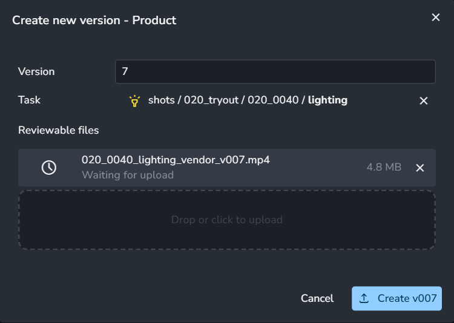
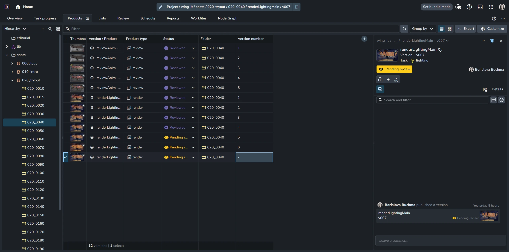

# Track work without a pipeline

<Columns widths="45 55">
<Column>

Not every piece of work reaches AYON through the pipeline. A vendor sends a movie, a freelancer works outside the studio, or the studio runs another pipeline and uses AYON only to track the production. The web app can turn any movie or still into a version of a shot or task, so it can be reviewed, commented on and approved like published work. How the upload works is described in [Upload version](../ayon/web-ui/dialogs/upload-version.md).

</Column>
<Column>

</Column>
</Columns>

## Review work that comes from outside

A coordinator can upload a vendor delivery or a freelancer's movie straight onto the shot or task it belongs to. It becomes a version with its own number, next to the studio's own versions, and plays in the [web viewer](../ayon/web-ui/web-viewer.md) and in [review sessions](review-and-approve.md). Uploaded and published versions share one numbering, so a shot's history stays in order whichever way each version arrived. A version number in the file name, such as `_v003`, is taken over for a new product.

## Track a production without the AYON pipeline

A studio that uses another pipeline, or none, can still track its production in AYON: the hierarchy, tasks, assignees, statuses, planning, review and reports all work without the pipeline tools. Uploading review media is then how work shows up on the tasks. What the AYON pipeline adds on top is described in [What the pipeline brings to production tracking](pipeline.md).

## Show several takes in one version

One upload can hold several files, and each becomes a reviewable of the version, labelled with its file name: several angles of an animation, a movie and a still, or a model under different lighting. Reviewables with the same label are matched when versions are compared in the viewer. More files can be added to the version later in its [Version files tab](../ayon/web-ui/details-panel.md#version-files-tab).

## Know the limits

Uploaded versions hold review media only. Their files are stored on the AYON server, not in the project storage of the anatomy, so:

- Pipeline tools in an application cannot load them; another department cannot build on them.
- They have no representations, so the delivery tools that copy published files do not apply to them; see [Prepare deliveries](deliveries.md).
- Files are not converted on upload; they must be in a format the browser plays, see [Supported formats](../ayon/web-ui/web-viewer.md#supported-formats).

When the files need to be part of the pipeline, for example plates from a vendor, they are published with the [Tray Publisher](../addons/essentials/traypublisher/index.md) instead, which puts them in the project storage.

## Related

- [Upload version](../ayon/web-ui/dialogs/upload-version.md)
- [Review and approve](review-and-approve.md)
- [What the pipeline brings to production tracking](pipeline.md)
- [Products and versions](../ayon/web-ui/production-tracking/products.md)
