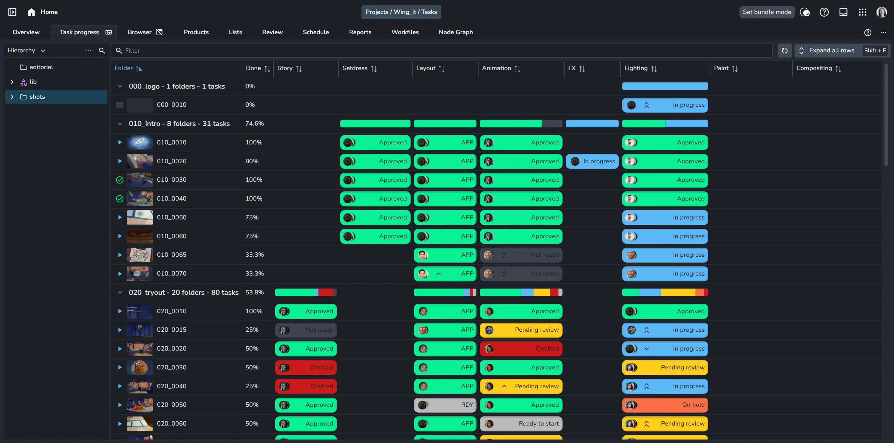
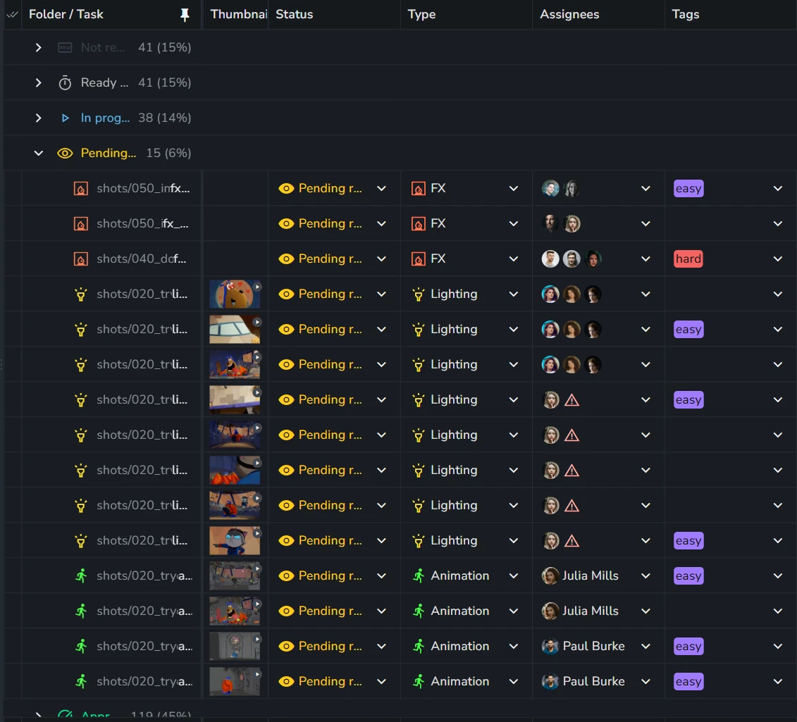
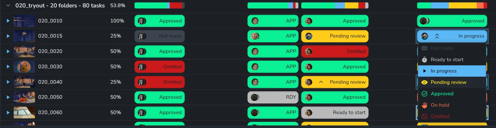
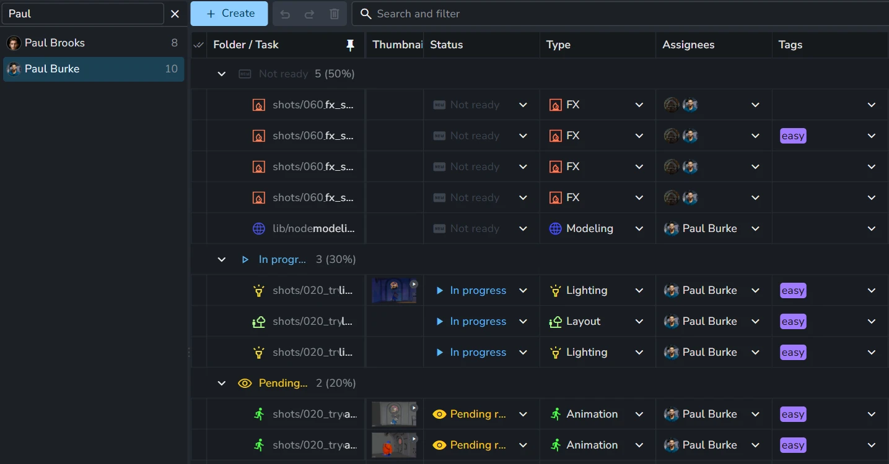
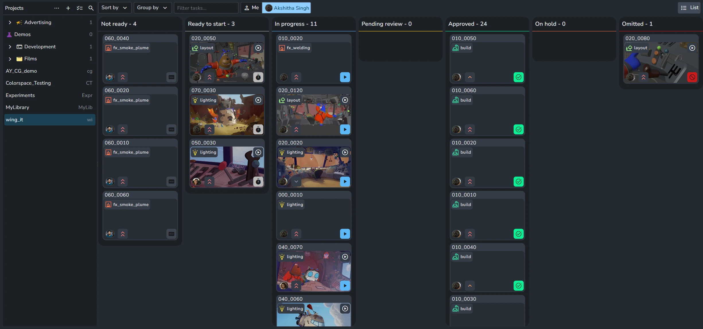

# See where every task stands

A production is a few thousand tasks moving through statuses. AYON keeps all of them in the project, so producers and coordinators can answer "where are we?" without asking around: for the whole project, for one sequence, for one department or for one artist. The pages that show this are part of the web app and need no pipeline: statuses can be changed by hand, and with the [pipeline](../pipeline/index.md) they are backed by the work artists publish.

## Statuses that mean something

Every task, folder and version has a status from the list of its project, such as **Ready to start**, **In progress**, **Pending review** or **Approved**. Each status also has a state (not started, in progress, done or blocked). Progress is counted by state, not by name: a task counts as finished when its status has the done state, so two projects can name their statuses differently and still be compared. Statuses, their colors and which entities can use them are part of the [project anatomy](../ayon/web-ui/project/anatomy.md); the default list and how statuses are used during a production are described in [Production workflow](../ayon/how-ayon-works/production-workflow.md#3-assign-people-and-statuses).

## The whole project in one table

The [Project overview](../ayon/web-ui/production-tracking/overview.md) shows every folder and task of a project as a spreadsheet: status, assignees, priority, dates and any other attribute, edited in place like cells. Grouping the table by status, assignee or task type turns it into a breakdown of the project, for example everything that is waiting for review, or every task of one artist. New shots and tasks can be added in the same table, or imported from a spreadsheet with [Import CSV](../ayon/web-ui/dialogs/import-csv.md).

With the [Power Pack](../addons/production-tracking/power-pack/index.md), the table also counts and sums its columns, such as the number of tasks per status or the total frame count of a sequence, and exports to Excel or CSV for sharing outside AYON.

## How far each shot is, in every department

[Task progress](../ayon/web-ui/production-tracking/task-progress.md) shows a project as a grid: one row per shot or asset, one column per task type, with the status and assignees of each task in its cell and a done percentage per row. It answers "how far is this sequence?" at a glance and shows where work is stuck, such as a column of lighting tasks still waiting for animation. Selecting many cells changes their status, assignees or priority in one go, for example to set a whole sequence to **Ready to start** when the layout is approved.

## Focus on what matters, and keep it

A project page can be narrowed with the [slicer](../ayon/web-ui/slicer.md) on the left, to one sequence, one assignee, one status or one list, and with filters on any attribute. Typical views are the tasks of one department, the shots of the next delivery, or everything on hold.

A filtered and grouped layout can be saved as a [view](../ayon/web-ui/views.md) and switched back to later. Views can be shared with the team, and a project can get a default view, so everyone opens the page with the same layout, for example a coordinator's daily check of what changed status.

## What each artist is working on

[Home tasks](../ayon/web-ui/home/tasks.md) is where artists find their own tasks across projects, as a board by status. Producers and coordinators can open the same board for one or more other users, or for all users, to see what each person has on their plate, spot someone with too much in progress, or hand tasks over. How much each person can take on, and when, is planned with the Planner; see [Planning](planning.md).

## Numbers that update themselves

With the Power Pack, attributes can be calculated by formulas instead of being typed in: the frame length of a shot from its frame range, the number of tasks still open in a sequence, or a progress text on each folder. They update as the work changes and can be shown, grouped and filtered like any other attribute; see [Calculated attributes](../addons/production-tracking/power-pack/calculated-attributes.md).

## Related

- [Project overview](../ayon/web-ui/production-tracking/overview.md)
- [Task progress](../ayon/web-ui/production-tracking/task-progress.md)
- [Slicer](../ayon/web-ui/slicer.md) and [Views](../ayon/web-ui/views.md)
- [Home tasks](../ayon/web-ui/home/tasks.md)
- [Production workflow](../ayon/how-ayon-works/production-workflow.md)
