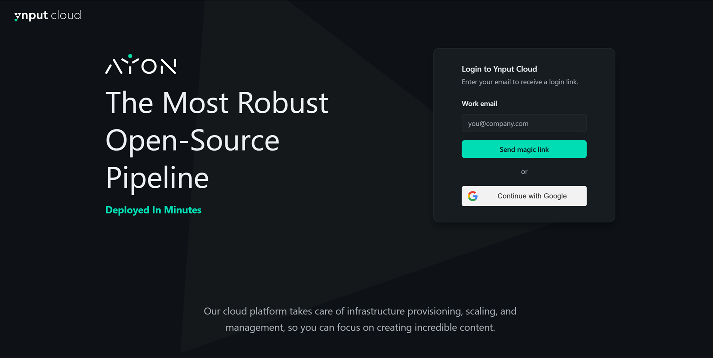
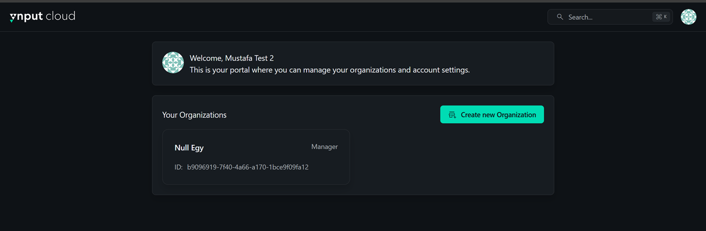
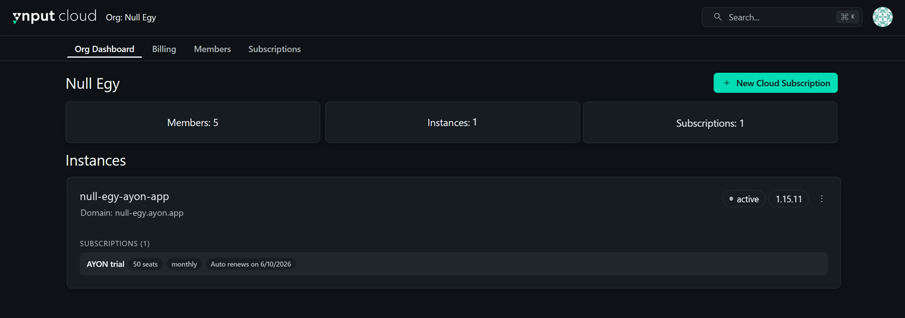
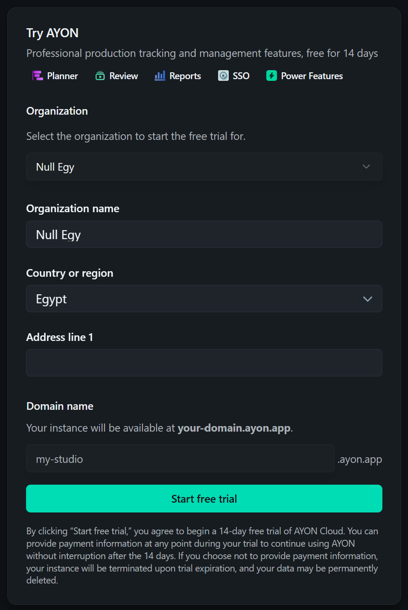
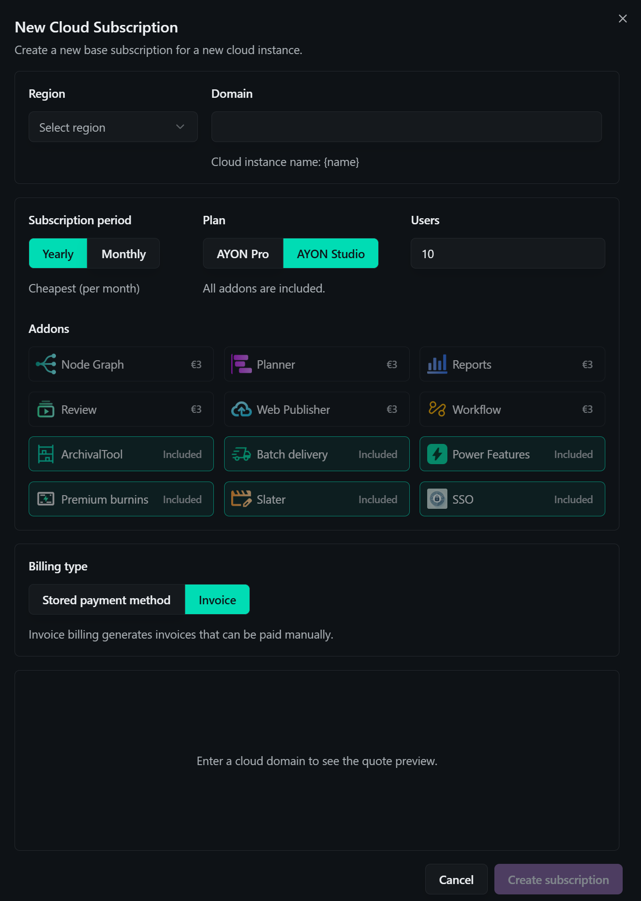
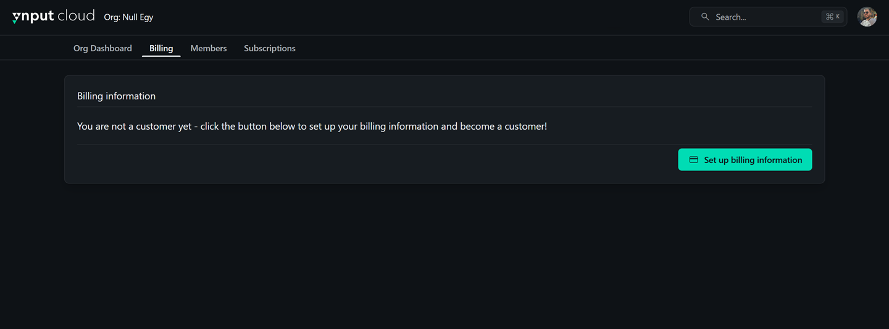
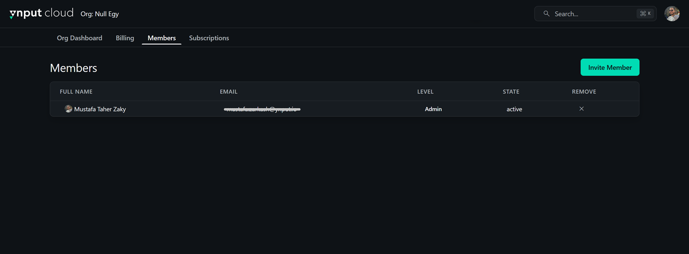

# Ynput Cloud

[Ynput Cloud](https://ynput.cloud/) is where studios manage their AYON subscriptions and launch AYON servers hosted by Ynput. It handles accounts, organizations, subscriptions, seats, addons and billing. The production work happens on the AYON server itself.

A subscription can be used in two ways:

- **With a server hosted by Ynput:** Ynput Cloud creates the server and Ynput runs it. What this includes is on the [cloud deployment](../ayon/deployment/cloud.md) page.
- **With a self-hosted server:** the studio runs the server on its own machines and connects it to the subscription to unlock the plan's features. See [on-premise deployment](../ayon/deployment/on-premise.md).

The plans and what they include are on the [plans](../ayon/plans.md) page.

## Accounts, organizations and instances

| Level | What it is |
|---|---|
| Account | A person's login on Ynput Cloud, used by producers or technical directors to manage billing, seats and subscriptions. |
| Organization | The studio. A person can create an organization or be invited to one. Members of an organization can invite teammates, change subscriptions and oversee billing. |
| Instance | An AYON server under an organization, with its own domain `<name>.ayon.app` and its own subscription. An organization can have several. Ynput Cloud calls it an instance (the help center calls it a workspace); this site calls it an AYON server. |

A Ynput Cloud account is not an account on the AYON server. Artists and managers use their AYON server account every day to track tasks, launch software and publish. The Ynput Cloud login can also be enabled as a login method for the AYON server, see the [Ynput Cloud addon](../addons/server-features/ynput-cloud/index.md).

## Log in

The login page of [Ynput Cloud](https://ynput.cloud/) offers two ways in: **Send magic link**, which emails a login link to the work email, or **Continue with Google**. No password is needed.

## Organizations

After logging in, **Your Organizations** lists the organizations of the account, each with its name, ID and the account's role in it. **Create new Organization** asks for a name and creates one. Someone invited to an organization finds it in the same list.

## Organization dashboard

Opening an organization shows its pages as tabs: **Org Dashboard**, **Billing**, **Members** and **Subscriptions**.

The **Org Dashboard** shows the number of members, instances and subscriptions, then the organization's **Instances**. Each instance shows:

- its name and domain;
- its state, such as **active**, and the AYON server version;
- its subscriptions, with the plan, the number of seats, the payment period and the renewal date;
- a `⋮` menu with the actions for the instance.

**New Cloud Subscription** at the top right creates a new instance, see [Create a cloud subscription](#create-a-cloud-subscription).

## Start a free trial

<Columns widths="55 45">
<Column>

**Start Free Trial** opens the **Try AYON** form for a 14-day trial server with the production tracking features, such as Planner, Review, Reports, SSO and the Power Features.

| Field | What it is |
|---|---|
| **Organization** | The organization the trial is for |
| **Organization name** | The name of that organization |
| **Country or region**, **Address line 1** | The studio's address |
| **Domain name** | The server's address, `<name>.ayon.app` |

**Start free trial** creates the server. Payment information can be added at any time during the trial to keep using the server after the 14 days. Without it, the server is terminated when the trial ends, and its data may be deleted permanently.

</Column>
<Column>

</Column>
</Columns>

## Create a cloud subscription

<Columns widths="55 45">
<Column>

**New Cloud Subscription** on the Org Dashboard opens a dialog that creates a commercial server and its subscription.

| Field | What it is |
|---|---|
| **Region** | The cloud region the server runs in. See data residency on the [cloud deployment](../ayon/deployment/cloud.md) page |
| **Domain** | The server's name and address, `<name>.ayon.app` |
| **Subscription period** | **Yearly**, the cheapest per month, or **Monthly** |
| **Plan** | **AYON Pro** or **AYON Studio** |
| **Users** | The number of seats |
| **Addons** | The premium addons. With AYON Pro, the addons with a price are added per user; AYON Studio includes all addons |
| **Billing type** | **Stored payment method**, or **Invoice** for invoices that are paid manually |

After a domain is entered, the dialog shows a quote preview. **Create subscription** creates the server. When it is ready, its link on the Org Dashboard opens the AYON web app.

</Column>
<Column>

</Column>
</Columns>

## Change a subscription

A change shows the amount due before it is confirmed.

- **Seats:** **Manage Seats** (also called **Update License Pool**) on the instance's subscription. Seats limit how many people can log in to the server, and can be reassigned between people. New seats are available right away on the server's [Users](../ayon/web-ui/studio/users.md) page.
- **Premium addons:** on an AYON Pro subscription, **Add** next to a premium addon activates its license for the server.
- **Media storage:** extra media storage is bought in blocks of 500 GB.

## Billing

The **Billing** tab holds the organization's billing information and payment methods, used for renewals. An organization without billing information shows **Set up billing information**.

## Members

The **Members** tab lists the people of the organization with their full name, email, level, such as **Admin**, and state. **Invite Member** invites someone, for example a production manager or a technical lead who helps manage seats, addons and subscriptions. The `×` in the **Remove** column removes a member.

## Data

A server connected to Ynput Cloud sends anonymous server settings and usage metrics, such as the server version and the number of projects, users and addons. This applies to servers hosted by Ynput and to self-hosted servers connected to a subscription. The production data is not collected: no creative assets, file names or artwork. An admin can see exactly what the server sends with the [metrics endpoint](/api#tag/System/operation/get_production_metrics) of the REST API.

Ynput's security, compliance and data processing policies are on the [Trust Center](https://trust.ynput.io/).

## Related

- [Cloud deployment](../ayon/deployment/cloud.md)
- [On-premise deployment](../ayon/deployment/on-premise.md)
- [AYON plans](../ayon/plans.md)
- [Ynput Cloud addon](../addons/server-features/ynput-cloud/index.md)
